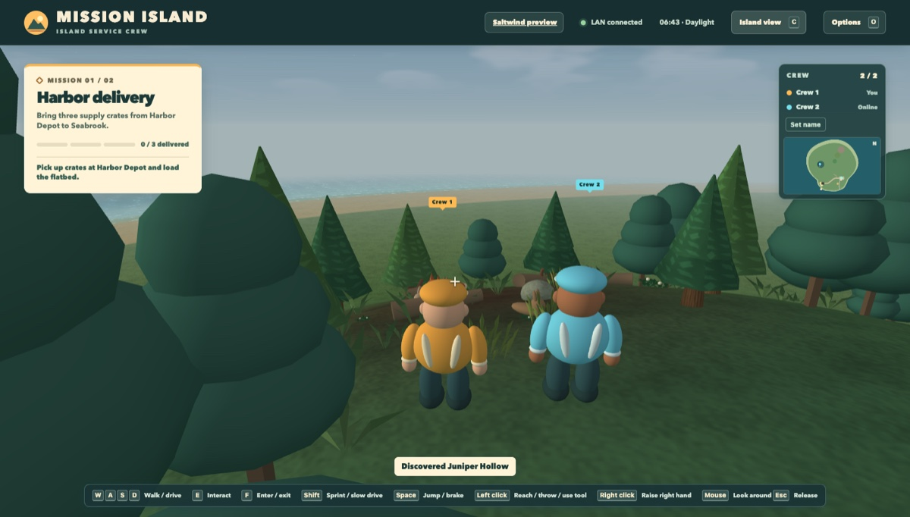

# Mission Island

One of you backs the flatbed up to the freight yard. The other loads the last crate and climbs aboard. At Seabrook, the first crate you hand over earns coins for both of you. On the way home, there’s time to stop at the fishing dock you passed on the way out.

Mission Island is a third-person browser game for a crew of two. One computer hosts a persistent island. You each join from your own screen, share a bank, and decide how to spend the day. You can finish jobs solo, too.



*Juniper Hollow during a two-player wildlife playtest.*

## Take your first shift

- **Earn your first payday.** Pick up the flatbed at Harbor Depot and take supplies to Seabrook. Each crate pays two coins into the crew bank, even if one of you stays behind the wheel. Finish the delivery and tackle the Forest Lookout fire to open the depot’s job board.
- **Find your own rhythm.** Paddle the skiff together or cast from shore. Grow carrots at Island Farm and sell your harvest and catch at Seabrook Market. Either player can spend your earnings.
- **Take the long way home.** Leave the truck and follow a trail into Juniper Hollow. Look for hares breaking cover as a fox approaches. Get back to your cottages after dark and turn in together to skip to dawn. The host saves your progress between visits.

## Play on your local network

On the host computer, install Node.js 22.13 or newer. With Git installed, run these commands to start the game.

```sh
git clone https://github.com/brylie/mission-island.git
cd mission-island
npm ci
npm run dev
```

1. Open the **Local** address printed in the host’s terminal. Keep that terminal running.
2. Press **O** for **Options → Invite a crewmate → Copy LAN link**. Share that link, including its port, with the second player on the same network. They only need a desktop browser with WebGL, a keyboard, and a mouse.
3. When the crew panel shows both players, open **Crew guide** or head to Harbor Depot. Use **WASD** to walk, **E** for the action shown, and **F** to board the stopped truck.

If the second computer can’t connect, check that the network allows devices to reach each other and that the host firewall allows incoming connections to Node. For controls, save slots, and returning to the same crew, see the [player guide](docs/player-guide.md). To try the opening with two newcomers, use the [fresh-save playtest guide](docs/playtests/starter-island-first-payout.md).

## Beyond the fishing dock

The crew’s longer-term goal is to repair the ferry terminal at the end of Harbor Depot road. We’re building toward an island where residents remember a favor, a wildlife sighting is worth bringing home, and local jobs help restore the crossing. You can already tour the larger island via **Saltwind preview**. Ferry travel and restoration are planned. [Starter Island milestone](https://github.com/brylie/mission-island/milestone/4) · [Saltwind tour](docs/saltwind-island.md)

Explore the [design handbook](docs/README.md) for the vision and mechanics, or [contribute](CONTRIBUTING.md) a playtest finding, a habitat, or a change to the game.
