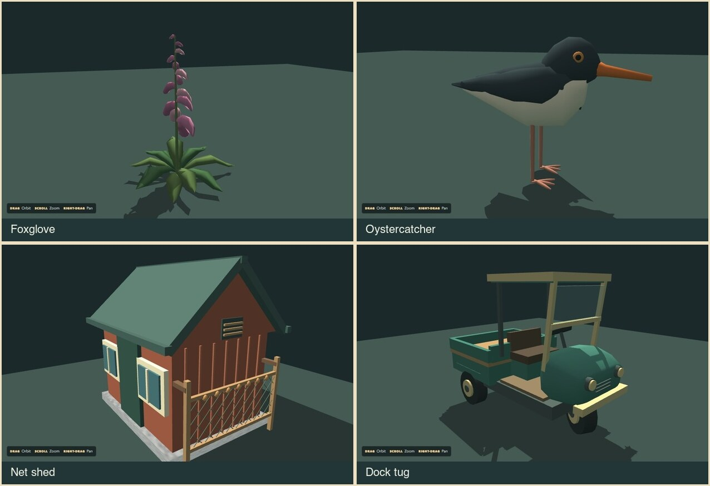
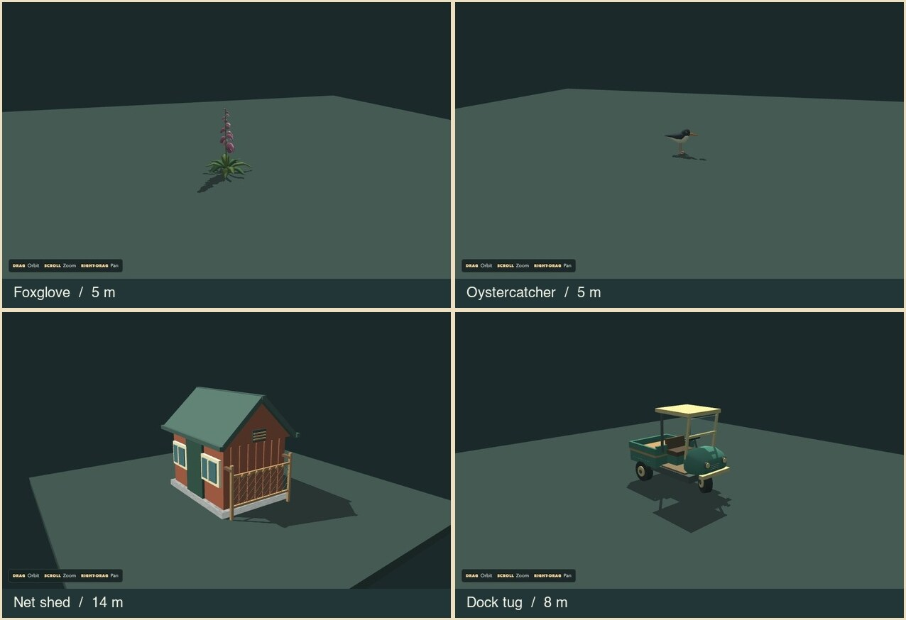

# Building island models in code

The [crew turnaround](crew-character-art.md) gives Mission Island softly shaped silhouettes, generous working parts and a few carefully placed details. These four Workbench studies translate that direction into the meshes the game can draw. Each is a reusable TypeScript factory. The source files contain the complete models, colors, attachments and poses.

## Four examples to build from

| Study | What should read first | What rewards a closer look | How the agent built it |
| --- | --- | --- | --- |
| [Foxglove](http://localhost:5173/workbench.html#foxglove) | A tall flower spike rises from a low rosette. Bells narrow toward the tip. | The leaves crease along their length. Each flower curls back on itself to leave a hollow throat. | A folded four-sided leaf and a ten-sided bell repeat with different orientation, scale and height. **Specimen** chooses a repeatable arrangement. The stem sways from the base. [Source](../../src/assets/foxglove.ts) |
| [Oystercatcher](http://localhost:5173/workbench.html#oystercatcher) | A dark mantle, pale belly and long orange bill identify a wader in profile. | Switch off **Probe for food** to watch the head scan. Scrub a feeding stroke and follow the bill while the feet stay planted. | A few tapered cross-sections shape the belly, folded wings, hood and bill. The head and breast have separate pivots. [Source](../../src/assets/oystercatcher.ts) |
| [Harbor net shed](http://localhost:5173/workbench.html#net-shed) | A red gable and outdoor rack give the building a working side. | The net terminates at the frame, corks run along its top and a slatted vent serves the loft. | The existing house factory supplies doors, windows and roof geometry at game scale. Narrow diagonals and corks tell the story on one elevation. [Source](../../src/assets/net-shed.ts) |
| [Dock tug](http://localhost:5173/workbench.html#dock-tug) | The short bonnet, single front wheel and low rear deck explain how freight moves. | Orbit through the open driving step. Turn the front wheel to check clearance beneath the bonnet. | A shaped motor cover joins a simple chassis. The windshield, stepped seat, deck and steering fork each occupy their own space. [Source](../../src/assets/dock-tug.ts) |

## What held up at play distance

At 5 m the foxglove’s taper and the bird’s bill carry most of their identity. The eye ring and individual flower throats belong to close observation. At 14 m the rack is visible against the shed wall, but its fine lattice could also read as a fence. Placing it beside a landing with nets being taken ashore would give the shape context. At 8 m the tug’s canopy, open step and deck are distinct. A crate beside a standing crew member is the next test of its loading height.

| One specimen in the studio | Meshes | Triangles |
| --- | ---: | ---: |
| Foxglove | 26 | 2,332 |
| Oystercatcher | 18 | 2,168 |
| Net shed | 63 | 1,862 |
| Dock tug | 51 | 1,576 |

These are Workbench counts before island batching. Repeating every bell, cork or foot in a large population could cost more draw calls than its triangle count suggests. Before placing a meadow or flock, measure frame time at the intended density on the playtest laptops. For a distant plant, try keeping the color and taper of the spike. For a distant bird, keep the bill and the feeding stroke.

## Handing an asset to another agent

1. Name the subject, its job or habitat, its real size in metres, and the distance at which a player should recognize it. Pick the two or three shapes that will do that work. Use a reference photo when the profile or movement is unfamiliar.
2. Start with an existing factory under `src/assets/`. Block out a side profile and a three-quarter view in the Workbench. Use a tapered profile when a head, petal or bonnet changes shape along its length. Let broad materials and a small accent carry the color.
3. Add one detail with a reason to be there. Attach it to the part that owns its motion. For generative assets, share a specimen seed. For moving parts, share an animation time or steering angle.
4. Save a close view and a measured play-distance view in the same lighting. Record mesh and triangle counts. Orbit behind and below the asset to inspect normals and joints. Run **Check z-fighting**, investigate the reported pairs, then review in motion.
5. Before placing it on an island, test it with its neighbors. Put the plant in a patch, the bird at a waterline, the shed beside a crew member and a path, or the tug next to a crate. Check scale, visibility, collisions and performance in that context.

This pass establishes a repeatable level of detail for isolated models. Island placement, a population performance test, wildlife navigation and driveable tug handling are separate integration work.
