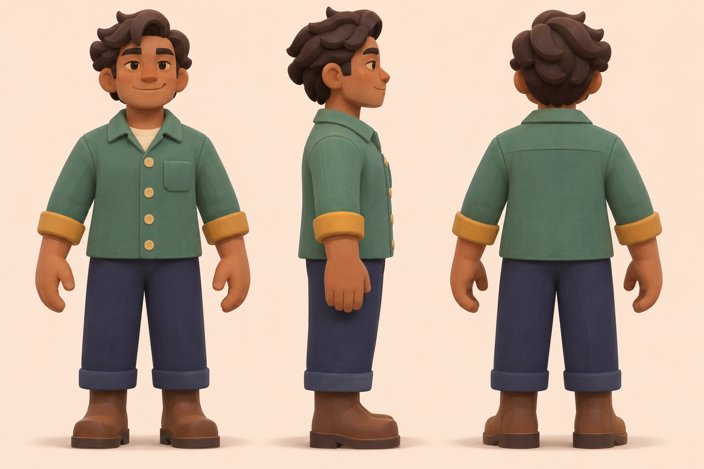
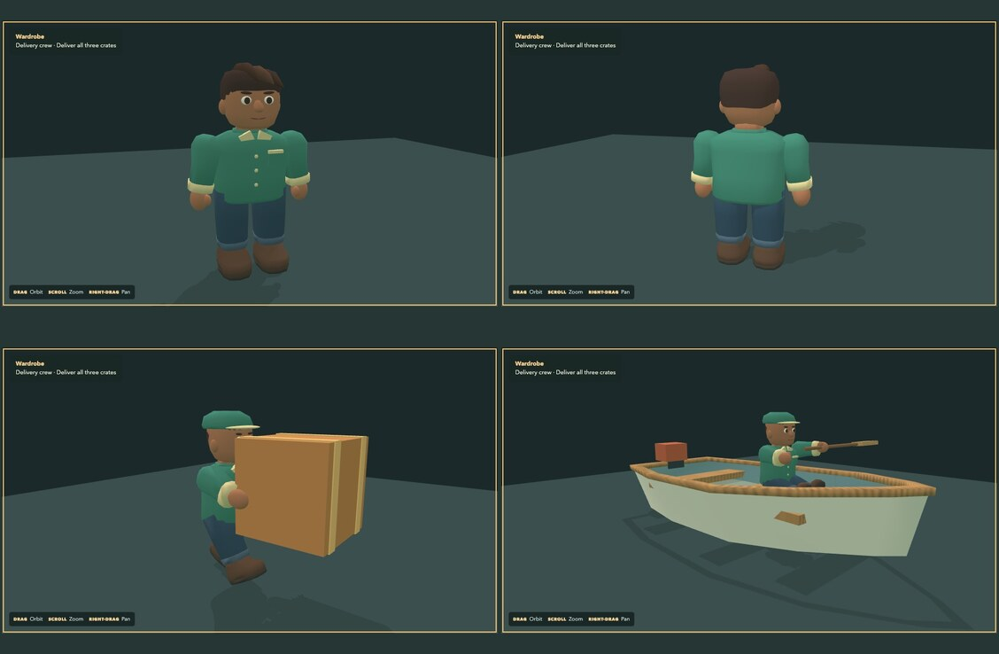
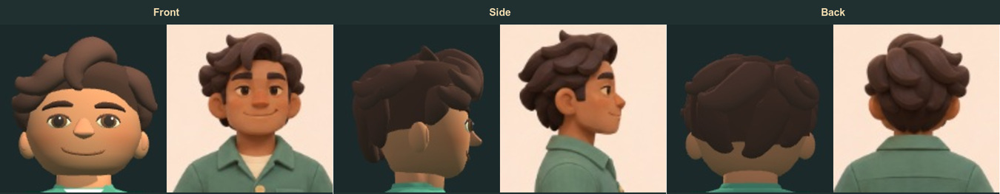
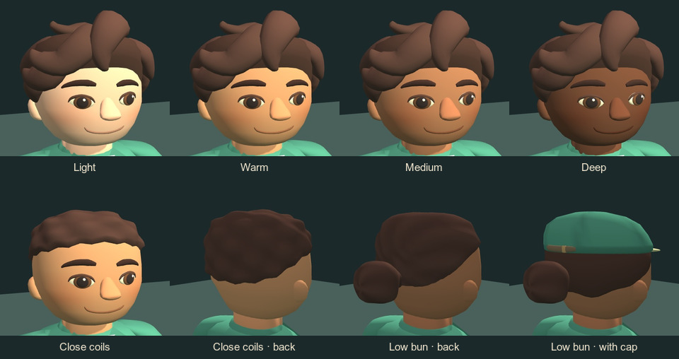
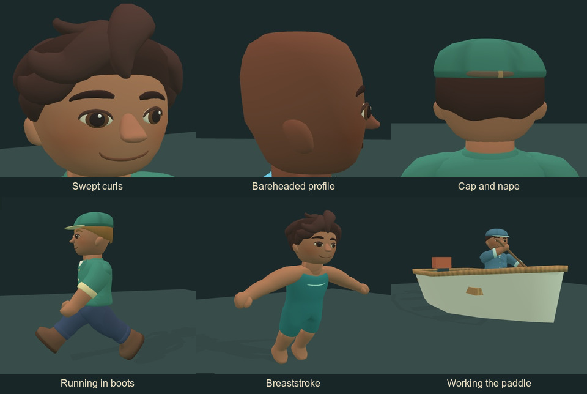
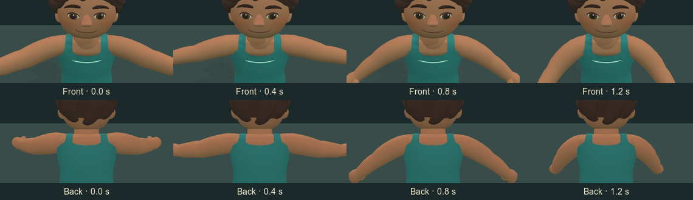
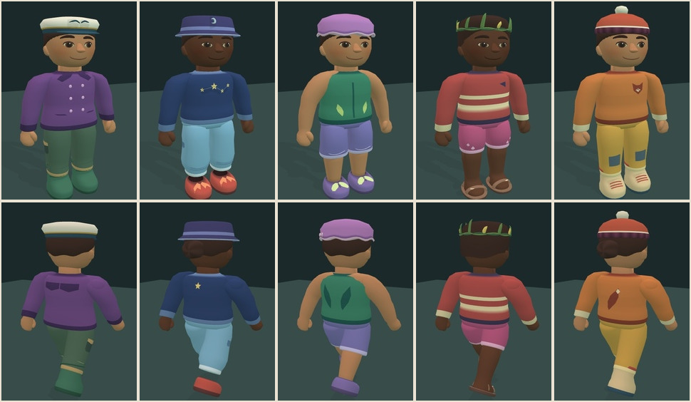

# Crew character art direction

**Approved visual direction.** The first in-engine fitting keeps the shared crew’s existing standing height, shoulder and hip pivots, and tool grip locations. Aim for a small, sturdy islander you would recognize from behind at the end of the pier. Take warmth, expressive faces and readability at a distance from Animal Crossing. Find Mission Island’s own character in the cut of a harbor work shirt, a well-worn pair of deck boots, and how someone shifts their weight to lift a crate.

This generated concept explores one person and one outfit. The broad shapes and proportions are the reference. Fabric grain, individual fingers and tiny fasteners can disappear at game scale.

## Shapes to carry into the model

| Part | First fitting |
| --- | --- |
| Figure | Try roughly four heads from sole to crown. Keep the current standing height and grip positions in world space. Give the shoulders a short slope, leave air between elbows and waist, and plant the soles flat. |
| Face | Let the forehead flow into full cheeks and a softly squared chin. Give the face a shallow front plane so the eyes and mouth sit on the face. Let a small wedge nose break the profile. Movable brows, an occasional blink and a slight smile should carry an expression with very little geometry. |
| Hair and headwear | Group hair into a few broad locks. A part, fringe or curl should make a person recognizable from the side. Fit a cap to the crown and keep enough hair at the temple or nape to preserve identity. Try close-cropped and tightly curled styles as well as the sweep on the sheet. |
| Clothes and hands | Give a shirt a shoulder seam, a cuff opening and a weighted hem. A gently boxy jacket paired with tapered sleeves makes the torso readable from behind. Shape the hand around a palm and thumb so a paddle or handle appears held. |
| Legs and feet | Let trousers hang in two distinct columns. A turned hem, a toe that points forward and a shallow heel give direction to a walking foot. |
| Color and finish | Use broad matte color fields, one small workwear accent and quiet shadows. A pocket flap, hat brim or rolled cuff can identify an outfit even when two players choose the same dye. Check brows and mouth against every starting skin tone in daylight and dusk. |

## First playable fitting

The shared crew factory now builds a canvas shirt with a weighted hem, rolled cuffs and a pocket, shaped trousers, flat-soled boots, and a thumb beside each grip. The cheeks taper into a chin. The hairline wraps around the nape and a swept fringe shows when the cap comes off. Uniform colors, skin tones and blinking use the existing appearance system. Inspect the same character in **Wardrobe → Crew character** or walk behind them in the **Coastal meadow** Composer preset.

## Approved silhouette and facial style

Open **Wardrobe → Crew character → Compare turnaround**. Use **Front** to compare cheek width, the shoulder line and how much trouser shows below the shirt. Use **Side** to compare the nose, the sweep of the fringe and the toe of the boot. **Back** is the view players see on the walk to the harbor. Look for the nape above the collar and clear space between the forearms and the shirt.

The **Swept curls** style has a rolled forelock above one brow, staggered tips at the temples, and overlapping locks sweeping from the crown to the nape. The cap uses a smooth cropped silhouette at the temples and nape. Check that the hairline meets the cap cleanly from the front, side, and back. Keep the crown and nape recognizable at the usual follow distance.

**Close coils** sit close to the head and catch the light across a rounded, textured crown. **Low bun** pulls the hair back into a small knot at the nape, low enough to show beneath a work cap. Both are starting choices in the home wardrobe. In the Workbench, use the same hair color, pose, and light when comparing skin tones, then turn the figure to check how the face reads in shade.

The face uses a slightly raised brow, compact eyes with a warm iris and one small catchlight, a rounded wedge nose, and an off-center smile. Each ear is a small, smooth shape with a fuller upper edge and a tapered lobe that meets the cheek. Keep the inner surface quiet enough to read at follow-camera distance. The soft and wide smiles each follow the cheeks. Lip color follows skin tone, and a closed blink leaves a short lash line. Compare both smiles and eye shapes in the Workbench across the skin palette under **Daylight** and **Golden hour**.

The revised shirt hem sits about 0.77 m above the soles. The shoulder, hip and tool-grip pivots stay in their existing positions so the same base can carry a crate, paddle and swim. Try a cap, change the hair and skin colors, then switch to swimwear and bare feet. The Lagoon swimsuit has two broad straps across the inner shoulders, a scooped neckline in front and back, and bare outer shoulders. The straps share vertices with the body of the suit, which continues through both legs. Check the shoulder line and the hip silhouette with arms lowered, through the swim stroke, and seated in the skiff. The approved silhouette is the base for new wardrobe fittings.

## Motion and wardrobe fitting

Start in **Wardrobe → Crew character**. Pause **Sprint** mid-stride and orbit behind the raised heel. The shin and boot should swing together while the planted leg takes the weight. Repeat with bare feet. In **Swim**, watch both knees gather and extend through the stroke, then scrub back to **Idle** and check the shoulders around the neck.

For the Lagoon fitting, select **Shirt or swimsuit → Lagoon swimsuit** and **Animation → Swim**. Pause at 0.0, 0.4, 0.8 and 1.2 seconds, then orbit half a turn and scrub the same poses from behind. Watch where each strap crosses the shoulder as the arms spread and gather.

Switch to **Paddle skiff** and orbit along the gunwale. The lower hand works the blade on its own side while the opposite palm holds the upper shaft. Both knees bend beneath the seated figure. Use **Carry crate** to check the downward glance, then check the cap strap, nape and collar together from the follow-camera distance in Seabrook.

## Seabrook clothing counter fitting

In **Wardrobe → Crew character**, mix the counter items using **Hat**, **Shirt or swimsuit**, **Bottoms** and **Shoes**. All twenty pieces are available here before purchase. For an in-game check, buy an item at Seabrook’s clothing counter and apply it in the wardrobe.

- Pair the **Reedlight Crown** with each hairstyle and use **Carry crate**. Check the open weave against the crown of the head as the player looks down.
- Wear the **Kelpwing Vest** and **Shellstrap Sandals** during **Swim**. Orbit behind the figure and check the bare shoulders as the arms gather, then the straps over the toes as the ankles turn.
- Seat the **Signal Sail Trousers** and **Lighthouse High-Tops** in **Paddle skiff**. Scrub the stroke and check the knee patches, trouser cuffs and boot collars. Switch to **Sprint** and follow the raised heel.
- Compare the same piece on the market counter and on the player. Keep its cut, one identifying motif and the main color readable at follow-camera distance.

## Review with one playable figure

1. Open **Wardrobe → Crew character** in the Asset Workbench. Save the current front, side and rear views. Compare one proposed base in the same light and camera, first bareheaded, then with the existing cap. Use the third-person rear view for the deciding shot.
2. Put two crew in the same color shirt at Seabrook. Have one turn and walk away. Can the other player recognize them from their hair, hat or garment silhouette? At island-view distance, can they tell which way the figure faces?
3. Scrub **Carry crate**, **Raise right hand**, **Paddle skiff** and **Swim**. Watch the thumb meet the handle, the sleeve follow the shoulder, and the shirt stay closed across the back. Orbit behind both shoulders to check the reported pale protrusions. Keep a screenshot and pose if anything clips or flickers.
4. At normal play distance, compare the existing crew and the first fitting. Ask each player which feels more at home by the ferry and which details helped them decide. Choose the head size and shoulder shape together before fitting shop clothing or career uniforms.

Use the same base and attachment points for everyday clothes, work uniforms and swim gear. The shirt, hair and skin tone in the sheet are one possible combination. A player should still look like themselves when a raincoat or rescue vest covers most of their outfit.
