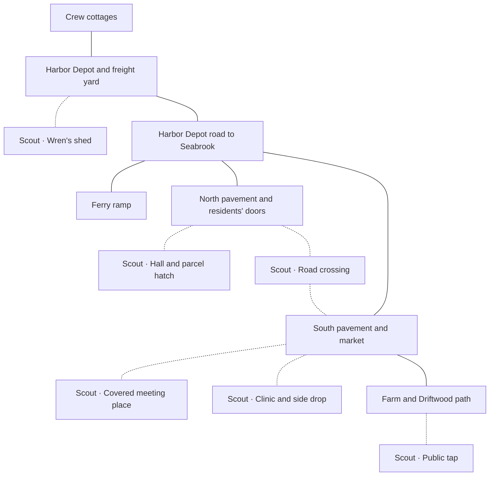

# Everyday services in Seabrook

**Proposed.** Build the village hall and its first parcel route before adding more services. Give each new place a practical reason to visit, a detail the crew can use in directions, and a reason to return. Test all three on one market morning. Use the [Starter Island play plan](starter-island-play-plan.md) to place the visit in the crew's week.

Ines trades food, seed and clothing at Seabrook Market across from her coral cottage. Bram keeps the freight tally at Harbor Depot. Wren works at the mending bench by the ferry approach. Mara fishes at the small dock. Keep those routines and routes recognizable as the village expands. [Residents and favors](../mechanics/resident-favors.md)

## Build sequence

| Place | Who and what happens there | First playable scope |
| --- | --- | --- |
| **1. Village hall, reading room and parcel counter** | Tove, a proposed hall keeper, lives behind the square, visits Ines before opening and walks home in the late afternoon. The hall has a local map, lending shelf and a sheltered notice wall with opening hours and one walking lead. | Scout an existing shell and use one public hatch. Bram sends one labeled parcel for a resident. Let the crew read the address, choose how to carry it and recognize the right door. Either player can finish for one shared payout. Keep the parcel and its outcome through reconnect and restart. Later, replacing a rain-damaged walking notice can leave a lasting trace of the crew's work. [#170](https://github.com/brylie/mission-island/issues/170) |
| **2. Market tea stall and covered tables** | Ines sets out tea on the trial morning. One visiting neighbor shares a local lead. Covered seats give players somewhere to meet after their separate errands. | Try a single morning in the existing square. Give the first hall test a marked shelter while the tables are being fitted. Keep produce, clothing and delivery approaches clear. Use the broader market-day and activity scheduler plans for recurrence. [#171](https://github.com/brylie/mission-island/issues/171) · [#9](https://github.com/brylie/mission-island/issues/9) · [#148](https://github.com/brylie/mission-island/issues/148) |
| **3. Public tap, seats and a dusk route** | A working tap on the farm walk lets players fill the watering can. A bench and lights mark where people wait or turn for home. | Show water flow and a clear fill cue as the player uses the tap. Keep today's can usable without refills. Check passing clearance and try seating when the shared sit interaction is ready. Reserve a damaged drain or loose lamp bracket as a later Wren repair. [#172](https://github.com/brylie/mission-island/issues/172) |
| **4. Mending shed** | Wren keeps the familiar bench and commute. A sheltered shelf holds dry supplies and a worn rack shows where loaned tools go. | Build around the playable toolbox and Materials checkout. Preserve freight staging and the truck's turning line. Later the shed can lend a handcart or set out gear for road work. [#173](https://github.com/brylie/mission-island/issues/173) |
| **5. Small clinic and response cupboard** | Nessa, a proposed nurse or first responder, lives off the market lane, spends mornings at the clinic and makes an afternoon round. Visiting hours and a sheltered side drop remain readable in the evening. | Try one optional delivery from the depot or market and a staffed conversation at the door. Add gear checkout when neighborhood response needs it. [#174](https://github.com/brylie/mission-island/issues/174) · [#97](https://github.com/brylie/mission-island/issues/97) |

Keep homes and workplaces in sight of ordinary routes. Use the hall and clinic thresholds for the first interactions, with room for an interior later. Make public notices readable after closing and give accepted errands a clear next visit or drop-off. Show the resulting Trust in how the resident greets either player or what they lend the crew.

## Service map and scouting points

The map shows connections. Dotted lines and **Scout** mark proposals. Coordinates in the table are metres `(x, z)` from the Starter Island layout. Walk the thresholds, cross the road with a loaded barrow and test turning with a loaded truck before choosing placements.

| Approach | Authored point or scouting candidate | Check at player height |
| --- | --- | --- |
| **Home to depot and ramp** | Crew cottages roughly `(-52, -4.65)` and `(-45, -4.65)`; depot board `(-43.7, -16.1)`; straight ramp at `(-30, -31)`. Wren's bench is already at `(-23.4, -15.8)`. | Keep the straight driving approach clear. Scout the shed behind the bench and reserve an off-road wait point beside the yard. |
| **North pavement to hall** | Pavement runs from `(30, 15.76)` to `(51, 15.76)`. Try the existing shell near `(35, 22)` as the hall. Ines already occupies the coral house at `(43, 22)`. | Face the hall notice toward the pavement. Leave two readers room to pass and provide a parcel set-down outside the walking line. Check Tove's home and commute before claiming any other shell. |
| **Crossing to market and shelter** | Road center through town near `z = 12`, south pavement near `z = 8.24`, market at `(39, 5.9)`. Ines already crosses near `(42, 12)`. | Scout a crossing near Ines's existing line with sightlines both ways. Stand under shelter near the market, clear of the canopy runoff, produce and clothing counters and delivery approach. [Market canopy #113](https://github.com/brylie/mission-island/issues/113) · [Workbench runoff comparison](../living-world-qa.md#seabrook-market-shower) |
| **Quieter lane to clinic** | Scout the existing shell near `(48, 2.6)` and its south-pavement connection. | Confirm the door is on a short, level approach, reserve room beside it for an arriving player, and pick a side drop clear of the waiting bench. |
| **Market to farm and beach** | Beach path starts near `(35, 12)` and passes `(33.1, 4)`. Farm barrels stand near `(28.75, -10.9)`. | Scout a tap off the path on the farm side of the market. Keep the barrels and beach approach usable. Use lamps at turns and crossings where a landmark disappears at dusk. |

[Buildings and harbor anchors](../../src/worlds/starter/layout/places.ts) · [Roads, paths and pavements](../../src/routes.ts) · [Doors, benches and lights](../../src/worlds/starter/layout/sites.ts)

## First two-player playtest · Market morning

Start from a disposable two-player save with produce ready to sell and the first parcel available. A sells produce at Ines's stall while B reads the hall notice and collects Tove's parcel. Meet at the covered tables or the marked market shelter. Read the address, choose how to carry it and work out the recipient's door together. Try a parcel of net floats for Mara's teal-roofed house by the depot trail. Hand carrying is the solo baseline. The flatbed is an option with room to pull over and unload. Test pavement clearance separately with the farm barrow loaded with carrots.

Both screens should show the same parcel destination and one payout. The next morning, ask both people to point out the house without a map marker and say what they would do if they met at the square again. Record where they needed a hint and what made them stay or leave. Repeat the approaches in rain and at dusk and check how the route reads when the hall is closed. [Shared milestone checklist #52](https://github.com/brylie/mission-island/issues/52)
