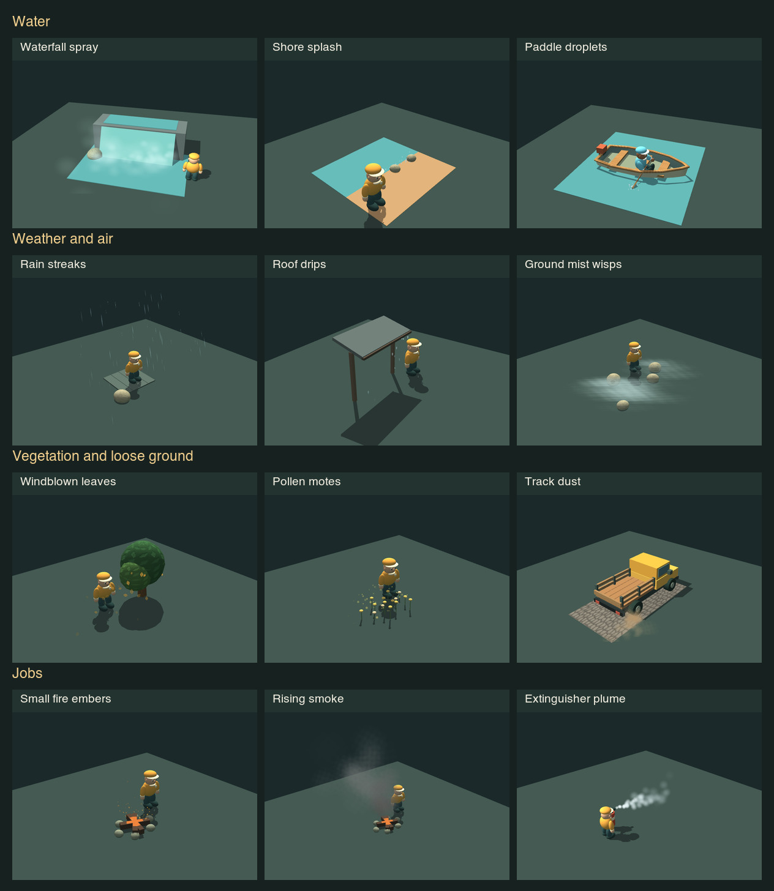
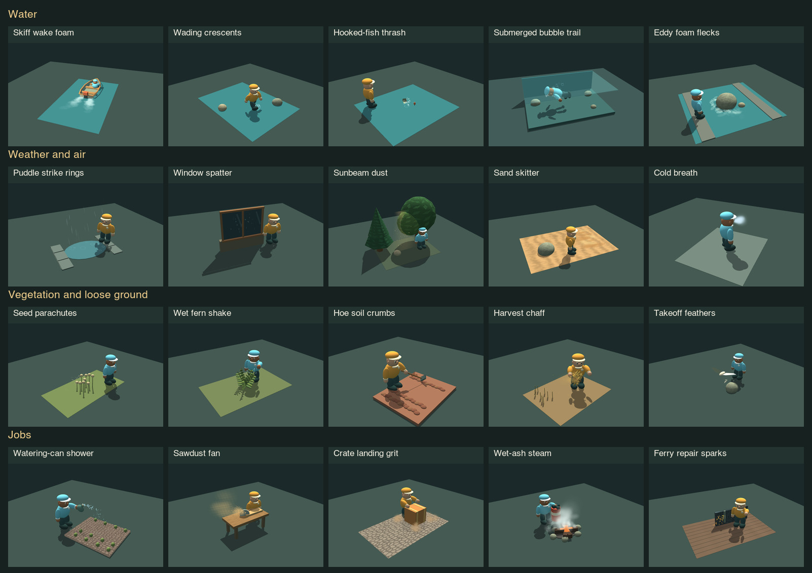
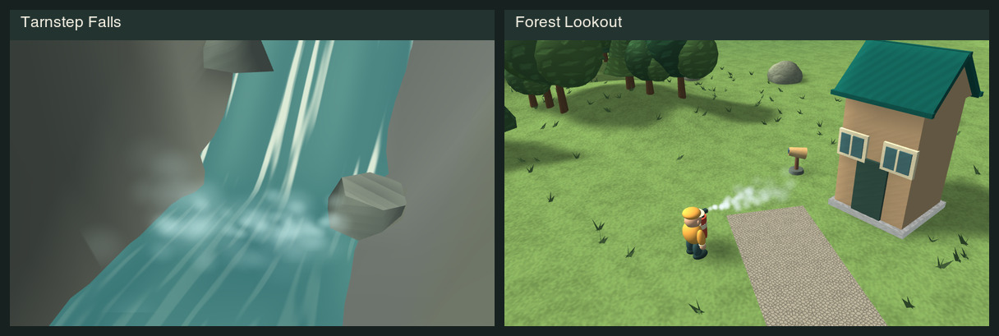

# Effects Workbench

Open **Effects** in the Asset Workbench. The shelf has 32 presets. Each has a strength control, a footprint control, and a replay seed. Wind changes the drift of rain, mist, loose leaves, pollen, and smoke. The reference crew, truck, skiff, eave, and fire bed show the effects at island scale.

Press **Play** or drag the timeline. The standard emission window runs from 0.25 s to 2.90 s. Continuous effects build through that window, while contact effects burst when a boot, tool or other source moves. Takeoff feathers uses a single launch. All 32 previews clear before the 6.25 s loop restarts. **Copy setup link** retains the seed, controls, time, camera, and field site. The links below assume the default local development port. Use the running Workbench host and port when sharing between computers.

## Existing effects inventory

| Source before this work | Shelf handoff |
| --- | --- |
| Extinguisher mist in the Workbench and multiplayer game | The existing `extinguisher` ID now opens the Extinguisher plume. The tool and spray share the same nozzle dimensions. |
| Lookout fire study with flame and smoke | The `fire` ID now opens Small fire embers. Rising smoke has its own entry and uses the same recipe as the live lookout smoke. The live fire also includes a flame layer. |
| Tarnstep and Fernfall spray, Mirror Lake and Mirror Pool dawn mist | Tarnstep uses the Waterfall spray recipe in the field and live preview. Ground mist wisps is a local effect for paths and small pockets of terrain. The regional dawn mist and Fernfall treatments use `src/island-phenomena.ts`. |
| Seabrook Market roof runoff, surf and tidal glow | The market has site-specific water and splash animation. Roof drips and shore splash use reusable droplet recipes. The market animation, surf shader and tidal glow use site-specific rendering. |

## Labeled previews

Each row opens a paused setup and gives an example use. The recipe modules define the shapes, lifetimes, and motion. The emitter factory supports preview bursts and live use. [Original recipes](../src/particle-recipes.ts) · [New recipes](../src/particle-shelf-recipes.ts) · [Emitter factory](../src/particle-effect.ts)

| Group | Setup | Stable ID | Example use |
| --- | --- | --- | --- |
| Water | [Waterfall spray](http://localhost:5173/workbench.html#waterfall-spray?setup=%7B%22version%22%3A1%2C%22name%22%3A%22Waterfall+spray%22%2C%22camera%22%3A%7B%22alpha%22%3A-1.33%2C%22beta%22%3A1.1%2C%22radius%22%3A16.560593123324217%2C%22fov%22%3A0.8%2C%22target%22%3A%5B0.00986875407397747%2C1.8489999897480012%2C0%5D%7D%2C%22time%22%3A2.8%2C%22options%22%3A%7B%22strength%22%3A1%2C%22footprint%22%3A1%2C%22seed%22%3A2962%7D%2C%22grid%22%3Afalse%2C%22wireframe%22%3Afalse%7D&light=daylight) | `waterfall-spray` | Water striking the plunge pool at Tarnstep Falls |
| Water | [Shore splash](http://localhost:5173/workbench.html#shore-splash?setup=%7B%22version%22%3A1%2C%22name%22%3A%22Shore+splash%22%2C%22camera%22%3A%7B%22alpha%22%3A0.74%2C%22beta%22%3A1.1%2C%22radius%22%3A11.104999985694885%2C%22fov%22%3A0.8%2C%22target%22%3A%5B0%2C1.8489999897480012%2C0%5D%7D%2C%22time%22%3A2.8%2C%22options%22%3A%7B%22strength%22%3A1%2C%22footprint%22%3A1%2C%22seed%22%3A4180%7D%2C%22grid%22%3Afalse%2C%22wireframe%22%3Afalse%7D&light=daylight) | `shore-splash` | A wave breaking on the rocks at Driftwood Beach |
| Water | [Paddle droplets](http://localhost:5173/workbench.html#paddle-droplets?setup=%7B%22version%22%3A1%2C%22name%22%3A%22Paddle+droplets%22%2C%22camera%22%3A%7B%22alpha%22%3A0.37%2C%22beta%22%3A1.1%2C%22radius%22%3A13.429999985694884%2C%22fov%22%3A0.8%2C%22target%22%3A%5B0%2C1.8489999897480012%2C0%5D%7D%2C%22time%22%3A2.21%2C%22options%22%3A%7B%22strength%22%3A1%2C%22footprint%22%3A1%2C%22seed%22%3A8602%7D%2C%22grid%22%3Afalse%2C%22wireframe%22%3Afalse%7D&light=daylight) | `paddle-droplets` | Water shedding from a skiff paddle blade |
| Weather and air | [Rain streaks](http://localhost:5173/workbench.html#rain-streaks?setup=%7B%22version%22%3A1%2C%22name%22%3A%22Rain+streaks%22%2C%22camera%22%3A%7B%22alpha%22%3A0.88%2C%22beta%22%3A1.1%2C%22radius%22%3A13.429999985694884%2C%22fov%22%3A0.8%2C%22target%22%3A%5B0%2C1.8489999897480012%2C0%5D%7D%2C%22time%22%3A2.8%2C%22options%22%3A%7B%22strength%22%3A1%2C%22footprint%22%3A1%2C%22wind%22%3A0%2C%22seed%22%3A7392%7D%2C%22grid%22%3Afalse%2C%22wireframe%22%3Afalse%7D&light=daylight) | `rain-streaks` | A passing shower over an exposed path |
| Weather and air | [Roof drips](http://localhost:5173/workbench.html#roof-drips?setup=%7B%22version%22%3A1%2C%22name%22%3A%22Roof+drips%22%2C%22camera%22%3A%7B%22alpha%22%3A0.63%2C%22beta%22%3A1.1%2C%22radius%22%3A10.515593049414456%2C%22fov%22%3A0.8%2C%22target%22%3A%5B-0.009868730232119649%2C1.8489999897480012%2C0%5D%7D%2C%22time%22%3A2.8%2C%22options%22%3A%7B%22strength%22%3A1%2C%22footprint%22%3A1%2C%22seed%22%3A8354%7D%2C%22grid%22%3Afalse%2C%22wireframe%22%3Afalse%7D&light=daylight) | `roof-drips` | Runoff falling from a gutter after a shower |
| Weather and air | [Ground mist wisps](http://localhost:5173/workbench.html#ground-mist?setup=%7B%22version%22%3A1%2C%22name%22%3A%22Ground+mist+wisps%22%2C%22camera%22%3A%7B%22alpha%22%3A0.79%2C%22beta%22%3A1.1%2C%22radius%22%3A13.429999985694884%2C%22fov%22%3A0.8%2C%22target%22%3A%5B0%2C1.8489999897480012%2C0%5D%7D%2C%22time%22%3A2.8%2C%22options%22%3A%7B%22strength%22%3A1%2C%22footprint%22%3A1%2C%22wind%22%3A0%2C%22seed%22%3A5183%7D%2C%22grid%22%3Afalse%2C%22wireframe%22%3Afalse%7D&light=daylight) | `ground-mist` | Dawn mist moving along the Mirror Lake bank |
| Vegetation and loose ground | [Windblown leaves](http://localhost:5173/workbench.html#windblown-leaves?setup=%7B%22version%22%3A1%2C%22name%22%3A%22Windblown+leaves%22%2C%22camera%22%3A%7B%22alpha%22%3A0.88%2C%22beta%22%3A1.1%2C%22radius%22%3A11.414999985694886%2C%22fov%22%3A0.8%2C%22target%22%3A%5B0%2C1.8489999897480012%2C0%5D%7D%2C%22time%22%3A2.8%2C%22options%22%3A%7B%22strength%22%3A1%2C%22footprint%22%3A1%2C%22wind%22%3A0%2C%22seed%22%3A3721%7D%2C%22grid%22%3Afalse%2C%22wireframe%22%3Afalse%7D&light=daylight) | `windblown-leaves` | Leaves falling from an alder on a windy verge |
| Vegetation and loose ground | [Pollen motes](http://localhost:5173/workbench.html#pollen-motes?setup=%7B%22version%22%3A1%2C%22name%22%3A%22Pollen+motes%22%2C%22camera%22%3A%7B%22alpha%22%3A0.88%2C%22beta%22%3A1.1%2C%22radius%22%3A9.864999985694885%2C%22fov%22%3A0.8%2C%22target%22%3A%5B0%2C1.8489999897480012%2C0%5D%7D%2C%22time%22%3A2.8%2C%22options%22%3A%7B%22strength%22%3A1%2C%22footprint%22%3A1%2C%22wind%22%3A0%2C%22seed%22%3A4475%7D%2C%22grid%22%3Afalse%2C%22wireframe%22%3Afalse%7D&light=daylight) | `pollen-motes` | A sunlit flower patch near the Long Acre orchard |
| Vegetation and loose ground | [Track dust](http://localhost:5173/workbench.html#track-dust?setup=%7B%22version%22%3A1%2C%22name%22%3A%22Track+dust%22%2C%22camera%22%3A%7B%22alpha%22%3A-0.87%2C%22beta%22%3A1.1%2C%22radius%22%3A16.684999985694887%2C%22fov%22%3A0.8%2C%22target%22%3A%5B0%2C1.8489999897480012%2C-0.04999999999999982%5D%7D%2C%22time%22%3A2.8%2C%22options%22%3A%7B%22strength%22%3A1%2C%22footprint%22%3A1%2C%22seed%22%3A7482%7D%2C%22grid%22%3Afalse%2C%22wireframe%22%3Afalse%7D&light=daylight) | `track-dust` | A rear truck tyre throwing dust off dry gravel |
| Jobs | [Small fire embers](http://localhost:5173/workbench.html#fire?setup=%7B%22version%22%3A1%2C%22name%22%3A%22Small+fire+embers%22%2C%22camera%22%3A%7B%22alpha%22%3A0.88%2C%22beta%22%3A1.1%2C%22radius%22%3A10.019999985694884%2C%22fov%22%3A0.8%2C%22target%22%3A%5B0%2C1.8489999897480012%2C0%5D%7D%2C%22time%22%3A2.8%2C%22options%22%3A%7B%22intensity%22%3A1%2C%22footprint%22%3A1%2C%22seed%22%3A1294%7D%2C%22grid%22%3Afalse%2C%22wireframe%22%3Afalse%7D&light=daylight) | `fire` | Sparks rising from the Forest Lookout fire bed |
| Jobs | [Rising smoke](http://localhost:5173/workbench.html#rising-smoke?setup=%7B%22version%22%3A1%2C%22name%22%3A%22Rising+smoke%22%2C%22camera%22%3A%7B%22alpha%22%3A0.88%2C%22beta%22%3A1.1%2C%22radius%22%3A14.389999985694885%2C%22fov%22%3A0.8%2C%22target%22%3A%5B0%2C2.536999989748001%2C0%5D%7D%2C%22time%22%3A2.8%2C%22options%22%3A%7B%22strength%22%3A1%2C%22footprint%22%3A1%2C%22wind%22%3A0%2C%22seed%22%3A1293%7D%2C%22grid%22%3Afalse%2C%22wireframe%22%3Afalse%7D&light=daylight) | `rising-smoke` | A smoke column above the active lookout fire |
| Jobs | [Extinguisher plume](http://localhost:5173/workbench.html#extinguisher?setup=%7B%22version%22%3A1%2C%22name%22%3A%22Extinguisher+plume%22%2C%22camera%22%3A%7B%22alpha%22%3A-0.73%2C%22beta%22%3A1.1%2C%22radius%22%3A14.979999985694885%2C%22fov%22%3A0.8%2C%22target%22%3A%5B0%2C1.8489999897480012%2C-1%5D%7D%2C%22time%22%3A2.8%2C%22options%22%3A%7B%22rate%22%3A155%2C%22footprint%22%3A1%2C%22seed%22%3A9011%2C%22mode%22%3A%22burst%22%2C%22busy%22%3Afalse%2C%22enabled%22%3Atrue%7D%2C%22grid%22%3Afalse%2C%22wireframe%22%3Afalse%7D&light=daylight) | `extinguisher` | A crew member spraying the Forest Lookout fire |

### Additional effects

The shared setups open after the motion has begun. Press **Restart** and **Play** to watch the skiff accelerate, step through a boot or tool contact, or follow the first lift of the bird.

| Group | Setup | Stable ID | Example use |
| --- | --- | --- | --- |
| Water | [Skiff wake foam](http://localhost:5173/workbench.html#skiff-wake-foam?setup=%7B%22version%22%3A1%2C%22name%22%3A%22Skiff+wake+foam%22%2C%22camera%22%3A%7B%22alpha%22%3A-1.23%2C%22beta%22%3A1.1%2C%22radius%22%3A18.836000008583067%2C%22fov%22%3A0.8%2C%22target%22%3A%5B0%2C1.0578000061511994%2C0%5D%7D%2C%22time%22%3A2.77%2C%22options%22%3A%7B%22strength%22%3A1%2C%22footprint%22%3A1%2C%22seed%22%3A4487%7D%2C%22grid%22%3Afalse%2C%22wireframe%22%3Afalse%7D&light=daylight) | `skiff-wake-foam` | A skiff accelerating across the harbor |
| Water | [Wading crescents](http://localhost:5173/workbench.html#wading-crescents?setup=%7B%22version%22%3A1%2C%22name%22%3A%22Wading+crescents%22%2C%22camera%22%3A%7B%22alpha%22%3A0.84%2C%22beta%22%3A1.1%2C%22radius%22%3A10.978500022888184%2C%22fov%22%3A0.8%2C%22target%22%3A%5B0%2C1.0363000164031984%2C0%5D%7D%2C%22time%22%3A2.56%2C%22options%22%3A%7B%22strength%22%3A1%2C%22footprint%22%3A1%2C%22seed%22%3A6164%7D%2C%22grid%22%3Afalse%2C%22wireframe%22%3Afalse%7D&light=daylight) | `wading-crescents` | Crew footsteps in the shallows |
| Water | [Hooked-fish thrash](http://localhost:5173/workbench.html#hooked-fish-thrash?setup=%7B%22version%22%3A1%2C%22name%22%3A%22Hooked-fish+thrash%22%2C%22camera%22%3A%7B%22alpha%22%3A0.89%2C%22beta%22%3A1.1%2C%22radius%22%3A9.255999994277953%2C%22fov%22%3A0.8%2C%22target%22%3A%5B0%2C1.0792999958992004%2C0%5D%7D%2C%22time%22%3A1.5%2C%22options%22%3A%7B%22strength%22%3A1%2C%22footprint%22%3A1%2C%22seed%22%3A4792%7D%2C%22grid%22%3Afalse%2C%22wireframe%22%3Afalse%7D&light=daylight) | `hooked-fish-thrash` | A hooked fish breaking the surface |
| Water | [Submerged bubble trail](http://localhost:5173/workbench.html#submerged-bubble-trail?setup=%7B%22version%22%3A1%2C%22name%22%3A%22Submerged+bubble+trail%22%2C%22camera%22%3A%7B%22alpha%22%3A1.27%2C%22beta%22%3A1.1%2C%22radius%22%3A10.933000001430512%2C%22fov%22%3A0.8%2C%22target%22%3A%5B0%2C0.4114000010251998%2C0%5D%7D%2C%22time%22%3A2.32%2C%22options%22%3A%7B%22strength%22%3A1%2C%22footprint%22%3A1%2C%22seed%22%3A3661%7D%2C%22grid%22%3Afalse%2C%22wireframe%22%3Afalse%7D&light=daylight) | `submerged-bubble-trail` | A swimmer crossing the harbor |
| Water | [Eddy foam flecks](http://localhost:5173/workbench.html#eddy-foam-flecks?setup=%7B%22version%22%3A1%2C%22name%22%3A%22Eddy+foam+flecks%22%2C%22camera%22%3A%7B%22alpha%22%3A1.15%2C%22beta%22%3A1.1%2C%22radius%22%3A10.436000022888184%2C%22fov%22%3A0.8%2C%22target%22%3A%5B0%2C1.0363000164031984%2C0%5D%7D%2C%22time%22%3A2.86%2C%22options%22%3A%7B%22strength%22%3A1%2C%22footprint%22%3A1%2C%22seed%22%3A5337%7D%2C%22grid%22%3Afalse%2C%22wireframe%22%3Afalse%7D&light=daylight) | `eddy-foam-flecks` | Water circling a rock below Tarnstep |
| Weather and air | [Puddle strike rings](http://localhost:5173/workbench.html#puddle-strike-rings?setup=%7B%22version%22%3A1%2C%22name%22%3A%22Puddle+strike+rings%22%2C%22camera%22%3A%7B%22alpha%22%3A1.12%2C%22beta%22%3A1.1%2C%22radius%22%3A8.613499965667724%2C%22fov%22%3A0.8%2C%22target%22%3A%5B0%2C1.2297999753952025%2C0%5D%7D%2C%22time%22%3A2.57%2C%22options%22%3A%7B%22strength%22%3A1%2C%22footprint%22%3A1%2C%22seed%22%3A8620%7D%2C%22grid%22%3Afalse%2C%22wireframe%22%3Afalse%7D&light=daylight) | `puddle-strike-rings` | Rain on the Seabrook Market path |
| Weather and air | [Window spatter](http://localhost:5173/workbench.html#window-spatter?setup=%7B%22version%22%3A1%2C%22name%22%3A%22Window+spatter%22%2C%22camera%22%3A%7B%22alpha%22%3A1.21%2C%22beta%22%3A1.1%2C%22radius%22%3A8.743093147166075%2C%22fov%22%3A0.8%2C%22target%22%3A%5B-0.17486876361072068%2C1.1007999856472015%2C0%5D%7D%2C%22time%22%3A2.48%2C%22options%22%3A%7B%22strength%22%3A1%2C%22footprint%22%3A1%2C%22seed%22%3A7189%7D%2C%22grid%22%3Afalse%2C%22wireframe%22%3Afalse%7D&light=daylight) | `window-spatter` | A windward window in a shower |
| Weather and air | [Sunbeam dust](http://localhost:5173/workbench.html#sunbeam-dust?setup=%7B%22version%22%3A1%2C%22name%22%3A%22Sunbeam+dust%22%2C%22camera%22%3A%7B%22alpha%22%3A1.1%2C%22beta%22%3A1.1%2C%22radius%22%3A11.601825007581713%2C%22fov%22%3A0.8%2C%22target%22%3A%5B-0.032249978542327806%2C1.6546400213241577%2C0%5D%7D%2C%22time%22%3A2.83%2C%22options%22%3A%7B%22strength%22%3A1%2C%22footprint%22%3A1%2C%22wind%22%3A0%2C%22seed%22%3A4193%7D%2C%22grid%22%3Afalse%2C%22wireframe%22%3Afalse%7D&light=daylight) | `sunbeam-dust` | Light shafts beneath the Pinewoods canopy |
| Weather and air | [Sand skitter](http://localhost:5173/workbench.html#sand-skitter?setup=%7B%22version%22%3A1%2C%22name%22%3A%22Sand+skitter%22%2C%22camera%22%3A%7B%22alpha%22%3A1.16%2C%22beta%22%3A1.1%2C%22radius%22%3A10.746000022888184%2C%22fov%22%3A0.8%2C%22target%22%3A%5B0%2C1.0363000164031984%2C0%5D%7D%2C%22time%22%3A2.93%2C%22options%22%3A%7B%22strength%22%3A1%2C%22footprint%22%3A1%2C%22wind%22%3A0%2C%22seed%22%3A7956%7D%2C%22grid%22%3Afalse%2C%22wireframe%22%3Afalse%7D&light=daylight) | `sand-skitter` | A beach gust reaching the sheltered side of a rock |
| Weather and air | [Cold breath](http://localhost:5173/workbench.html#cold-breath?setup=%7B%22version%22%3A1%2C%22name%22%3A%22Cold+breath%22%2C%22camera%22%3A%7B%22alpha%22%3A0.47%2C%22beta%22%3A1.1%2C%22radius%22%3A7.090999994277954%2C%22fov%22%3A0.8%2C%22target%22%3A%5B0%2C0.9717999958992004%2C0%5D%7D%2C%22time%22%3A2.66%2C%22options%22%3A%7B%22strength%22%3A1%2C%22footprint%22%3A1%2C%22wind%22%3A0%2C%22seed%22%3A5341%7D%2C%22grid%22%3Afalse%2C%22wireframe%22%3Afalse%7D&light=daylight) | `cold-breath` | A crew member exhaling at cold dawn |
| Vegetation and loose ground | [Seed parachutes](http://localhost:5173/workbench.html#seed-parachutes?setup=%7B%22version%22%3A1%2C%22name%22%3A%22Seed+parachutes%22%2C%22camera%22%3A%7B%22alpha%22%3A0.8%2C%22beta%22%3A1.1%2C%22radius%22%3A8.726000022888183%2C%22fov%22%3A0.8%2C%22target%22%3A%5B0%2C1.1438000164031983%2C0%5D%7D%2C%22time%22%3A2.81%2C%22options%22%3A%7B%22strength%22%3A1%2C%22footprint%22%3A1%2C%22wind%22%3A0%2C%22seed%22%3A5880%7D%2C%22grid%22%3Afalse%2C%22wireframe%22%3Afalse%7D&light=daylight) | `seed-parachutes` | A gust lifting seeds from the verge |
| Vegetation and loose ground | [Wet fern shake](http://localhost:5173/workbench.html#wet-fern-shake?setup=%7B%22version%22%3A1%2C%22name%22%3A%22Wet+fern+shake%22%2C%22camera%22%3A%7B%22alpha%22%3A0.97%2C%22beta%22%3A1.1%2C%22radius%22%3A8.301000008583069%2C%22fov%22%3A0.8%2C%22target%22%3A%5B0%2C0.9503000061511994%2C0%5D%7D%2C%22time%22%3A2.58%2C%22options%22%3A%7B%22strength%22%3A1%2C%22footprint%22%3A1%2C%22seed%22%3A3705%7D%2C%22grid%22%3Afalse%2C%22wireframe%22%3Afalse%7D&light=daylight) | `wet-fern-shake` | A crew member brushing past a wet frond |
| Vegetation and loose ground | [Hoe soil crumbs](http://localhost:5173/workbench.html#hoe-soil-crumbs?setup=%7B%22version%22%3A1%2C%22name%22%3A%22Hoe+soil+crumbs%22%2C%22camera%22%3A%7B%22alpha%22%3A0.7%2C%22beta%22%3A1.1%2C%22radius%22%3A7.09199997162819%2C%22fov%22%3A0.8%2C%22target%22%3A%5B0%2C0.9503000061511994%2C0.019999988079070996%5D%7D%2C%22time%22%3A2.42%2C%22options%22%3A%7B%22strength%22%3A1%2C%22footprint%22%3A1%2C%22seed%22%3A1807%7D%2C%22grid%22%3Afalse%2C%22wireframe%22%3Afalse%7D&light=daylight) | `hoe-soil-crumbs` | A hoe hitting loose soil in a furrow |
| Vegetation and loose ground | [Harvest chaff](http://localhost:5173/workbench.html#harvest-chaff?setup=%7B%22version%22%3A1%2C%22name%22%3A%22Harvest+chaff%22%2C%22camera%22%3A%7B%22alpha%22%3A0.8%2C%22beta%22%3A1.1%2C%22radius%22%3A7.486000022888184%2C%22fov%22%3A0.8%2C%22target%22%3A%5B0%2C1.1438000164031983%2C0%5D%7D%2C%22time%22%3A2.67%2C%22options%22%3A%7B%22strength%22%3A1%2C%22footprint%22%3A1%2C%22wind%22%3A0%2C%22seed%22%3A6680%7D%2C%22grid%22%3Afalse%2C%22wireframe%22%3Afalse%7D&light=daylight) | `harvest-chaff` | Straw and dust shaken from a cut barley bundle |
| Vegetation and loose ground | [Takeoff feathers](http://localhost:5173/workbench.html#takeoff-feathers?setup=%7B%22version%22%3A1%2C%22name%22%3A%22Takeoff+feathers%22%2C%22camera%22%3A%7B%22alpha%22%3A0.96%2C%22beta%22%3A1.1%2C%22radius%22%3A9.465999965667724%2C%22fov%22%3A0.8%2C%22target%22%3A%5B0%2C1.2297999753952025%2C0%5D%7D%2C%22time%22%3A0.83%2C%22options%22%3A%7B%22strength%22%3A1%2C%22footprint%22%3A1%2C%22wind%22%3A0%2C%22seed%22%3A2184%7D%2C%22grid%22%3Afalse%2C%22wireframe%22%3Afalse%7D&light=daylight) | `takeoff-feathers` | A bird startled off a rock |
| Jobs | [Watering-can shower](http://localhost:5173/workbench.html#watering-can-shower?setup=%7B%22version%22%3A1%2C%22name%22%3A%22Watering-can+shower%22%2C%22camera%22%3A%7B%22alpha%22%3A0.63%2C%22beta%22%3A1.1%2C%22radius%22%3A7.923000023841858%2C%22fov%22%3A0.8%2C%22target%22%3A%5B0%2C1.0792999958992004%2C0.19500000953674324%5D%7D%2C%22time%22%3A2.63%2C%22options%22%3A%7B%22strength%22%3A1%2C%22footprint%22%3A1%2C%22seed%22%3A4097%7D%2C%22grid%22%3Afalse%2C%22wireframe%22%3Afalse%7D&light=daylight) | `watering-can-shower` | Water arcing from the can’s rose into a vegetable bed |
| Jobs | [Sawdust fan](http://localhost:5173/workbench.html#sawdust-fan?setup=%7B%22version%22%3A1%2C%22name%22%3A%22Sawdust+fan%22%2C%22camera%22%3A%7B%22alpha%22%3A0.93%2C%22beta%22%3A1.1%2C%22radius%22%3A8.60100000858307%2C%22fov%22%3A0.8%2C%22target%22%3A%5B0%2C1.1653000061511993%2C0%5D%7D%2C%22time%22%3A2.72%2C%22options%22%3A%7B%22strength%22%3A1%2C%22footprint%22%3A1%2C%22seed%22%3A7703%7D%2C%22grid%22%3Afalse%2C%22wireframe%22%3Afalse%7D&light=daylight) | `sawdust-fan` | A blade throwing chips and dust at Timber Works |
| Jobs | [Crate landing grit](http://localhost:5173/workbench.html#crate-landing-grit?setup=%7B%22version%22%3A1%2C%22name%22%3A%22Crate+landing+grit%22%2C%22camera%22%3A%7B%22alpha%22%3A0.82%2C%22beta%22%3A1.1%2C%22radius%22%3A8.301000008583069%2C%22fov%22%3A0.8%2C%22target%22%3A%5B0%2C0.9503000061511994%2C0%5D%7D%2C%22time%22%3A2.85%2C%22options%22%3A%7B%22strength%22%3A1%2C%22footprint%22%3A1%2C%22seed%22%3A8272%7D%2C%22grid%22%3Afalse%2C%22wireframe%22%3Afalse%7D&light=daylight) | `crate-landing-grit` | Careful and hard cargo set-downs on gravel |
| Jobs | [Wet-ash steam](http://localhost:5173/workbench.html#wet-ash-steam?setup=%7B%22version%22%3A1%2C%22name%22%3A%22Wet-ash+steam%22%2C%22camera%22%3A%7B%22alpha%22%3A0.99%2C%22beta%22%3A1.1%2C%22radius%22%3A8.251000022888183%2C%22fov%22%3A0.8%2C%22target%22%3A%5B0%2C1.3588000164031984%2C0%5D%7D%2C%22time%22%3A2.81%2C%22options%22%3A%7B%22strength%22%3A1%2C%22footprint%22%3A1%2C%22seed%22%3A5817%7D%2C%22grid%22%3Afalse%2C%22wireframe%22%3Afalse%7D&light=daylight) | `wet-ash-steam` | The soaked fire bed at Forest Lookout cooling down |
| Jobs | [Ferry repair sparks](http://localhost:5173/workbench.html#ferry-repair-sparks?setup=%7B%22version%22%3A1%2C%22name%22%3A%22Ferry+repair+sparks%22%2C%22camera%22%3A%7B%22alpha%22%3A1.11%2C%22beta%22%3A1.1%2C%22radius%22%3A9.113500022888184%2C%22fov%22%3A0.8%2C%22target%22%3A%5B0%2C1.1438000164031983%2C0%5D%7D%2C%22time%22%3A2.67%2C%22options%22%3A%7B%22strength%22%3A1%2C%22footprint%22%3A1%2C%22seed%22%3A3819%7D%2C%22grid%22%3Afalse%2C%22wireframe%22%3Afalse%7D&light=daylight) | `ferry-repair-sparks` | A repair seam throwing hot sparks across the ferry deck |

## Destination checks

- **Tarnstep Falls.** The source sits 8 cm above the water mesh on cross-section Z 169 m. The default 5 m launch band fits the plunge pool at that cross-section. The field setup shows the spray where the cascade flattens out. A live Saltwind playtest opened frozen at 0 s with 86 particles in the pool and animated on resume. The spray-bow follow-up can use the shared `tarnstepSpraySource` and the Waterfall spray recipe to locate lit droplets. [Open the field setup](http://localhost:5173/workbench.html#waterfall-spray?setup=%7B%22version%22%3A1%2C%22name%22%3A%22Waterfall+spray%22%2C%22camera%22%3A%7B%22alpha%22%3A-1.33%2C%22beta%22%3A1.1%2C%22radius%22%3A12.189999496459944%2C%22fov%22%3A0.8%2C%22target%22%3A%5B-124.46732330322266%2C14.828999639129638%2C169%5D%7D%2C%22time%22%3A2.8%2C%22options%22%3A%7B%22strength%22%3A1%2C%22footprint%22%3A1%2C%22seed%22%3A2962%7D%2C%22grid%22%3Afalse%2C%22wireframe%22%3Afalse%7D&light=daylight&stage=island) · [Spray bow #39](https://github.com/brylie/mission-island/issues/39)
- **Forest Lookout.** The nozzle tip comes from the held tool’s world transform. The field setup shows the plume beside a full-size crew member. In the live fire mission the plume cleared after releasing the spray key. Both extinguisher pools, smoke and embers were empty after the fire was extinguished. The lookout recovery follow-up can use the existing fire state and footprint while the final particles drain. [Open the field setup](http://localhost:5173/workbench.html#extinguisher?setup=%7B%22version%22%3A1%2C%22name%22%3A%22Extinguisher+plume%22%2C%22camera%22%3A%7B%22alpha%22%3A-0.73%2C%22beta%22%3A1.1%2C%22radius%22%3A14.979999985694885%2C%22fov%22%3A0.8%2C%22target%22%3A%5B7%2C1.8489999897480012%2C28%5D%7D%2C%22time%22%3A2.8%2C%22options%22%3A%7B%22rate%22%3A155%2C%22footprint%22%3A1%2C%22seed%22%3A9011%2C%22mode%22%3A%22burst%22%2C%22busy%22%3Afalse%2C%22enabled%22%3Atrue%7D%2C%22grid%22%3Afalse%2C%22wireframe%22%3Afalse%7D&light=daylight&stage=island) · [Lookout recovery #46](https://github.com/brylie/mission-island/issues/46)

## Laptop playtest

The **Busy fire drill** stages two crew members, a flatbed and a fire bed in the full Forest Lookout scene. Four emitters supply the plume, embers, smoke and track dust. Both links open the same camera and time. Toggle **Show particles** to switch all four emitters in place. [Effects on](http://localhost:5173/workbench.html#extinguisher?setup=%7B%22version%22%3A1%2C%22name%22%3A%22Extinguisher+plume%22%2C%22camera%22%3A%7B%22alpha%22%3A-0.73%2C%22beta%22%3A1.1%2C%22radius%22%3A22.139999985694885%2C%22fov%22%3A0.8%2C%22target%22%3A%5B5.599999904632568%2C2.536999989748001%2C27.7%5D%7D%2C%22time%22%3A2.8%2C%22options%22%3A%7B%22rate%22%3A155%2C%22footprint%22%3A1%2C%22seed%22%3A9011%2C%22mode%22%3A%22burst%22%2C%22busy%22%3Atrue%2C%22enabled%22%3Atrue%7D%2C%22grid%22%3Afalse%2C%22wireframe%22%3Afalse%7D&light=daylight&stage=island) · [Effects off](http://localhost:5173/workbench.html#extinguisher?setup=%7B%22version%22%3A1%2C%22name%22%3A%22Extinguisher+plume%22%2C%22camera%22%3A%7B%22alpha%22%3A-0.73%2C%22beta%22%3A1.1%2C%22radius%22%3A22.139999985694885%2C%22fov%22%3A0.8%2C%22target%22%3A%5B5.599999904632568%2C2.536999989748001%2C27.7%5D%7D%2C%22time%22%3A2.8%2C%22options%22%3A%7B%22rate%22%3A155%2C%22footprint%22%3A1%2C%22seed%22%3A9011%2C%22mode%22%3A%22burst%22%2C%22busy%22%3Atrue%2C%22enabled%22%3Afalse%7D%2C%22grid%22%3Afalse%2C%22wireframe%22%3Afalse%7D&light=daylight&stage=island)

Measured on a MacBook Pro with Apple M1 Pro and 32 GB of memory on 21 November 2026. Brave used Chromium 157 with hardware-accelerated WebGL 2 through ANGLE Metal. The browser viewport was 1440 × 920 at device pixel ratio 1, with a 925 × 659 render surface. At 1× playback, the test ran Off → On → On → Off, discarded the first 6.25-second loop of each run, and sampled the next two complete loops.

| Run | Sampled frames | Peak live particles | Median frame interval | 95th-percentile frame interval | Median CPU frame time |
| --- | ---: | ---: | ---: | ---: | ---: |
| Off | 750 | 0 | 16.70 ms | 17.40 ms | 2.50 ms |
| On | 750 | 250 | 16.70 ms | 17.50 ms | 2.30 ms |
| On | 751 | 250 | 16.70 ms | 17.20 ms | 2.40 ms |
| Off | 750 | 0 | 16.70 ms | 17.40 ms | 2.30 ms |

Frame interval is the elapsed time between frame starts. CPU frame time runs from the engine’s begin-frame to end-frame event and includes preview updates and render submission. The four emitter pools were reused for every loop and all four had returned to zero live particles at 6.23 s. In separate checks, every studio preview produced identical particle positions after rewinding to the same seeded frame, and switching subjects released the previous scene’s pool.

To repeat the comparison, open either drill setup and wait for the scene to finish loading. Click **Restart** and **Play**. Record the render loop in the browser’s Performance panel after the first cycle. Compare the frame track and the **Particle playback** peak with **Show particles** off and on, using the same camera and viewport.
