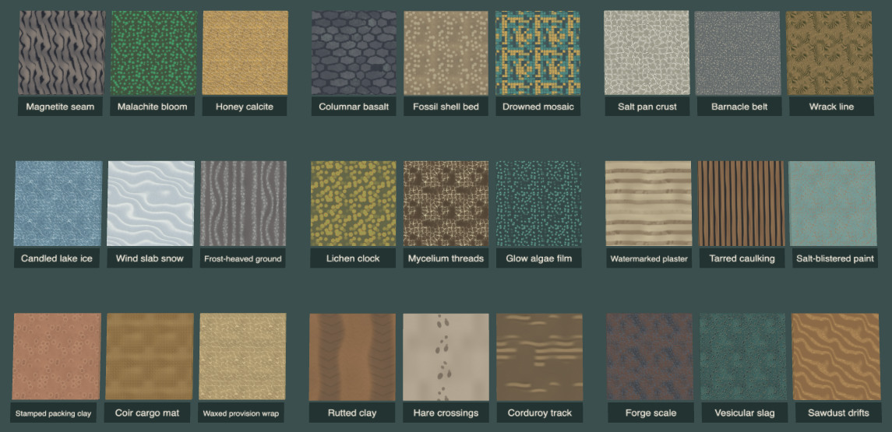
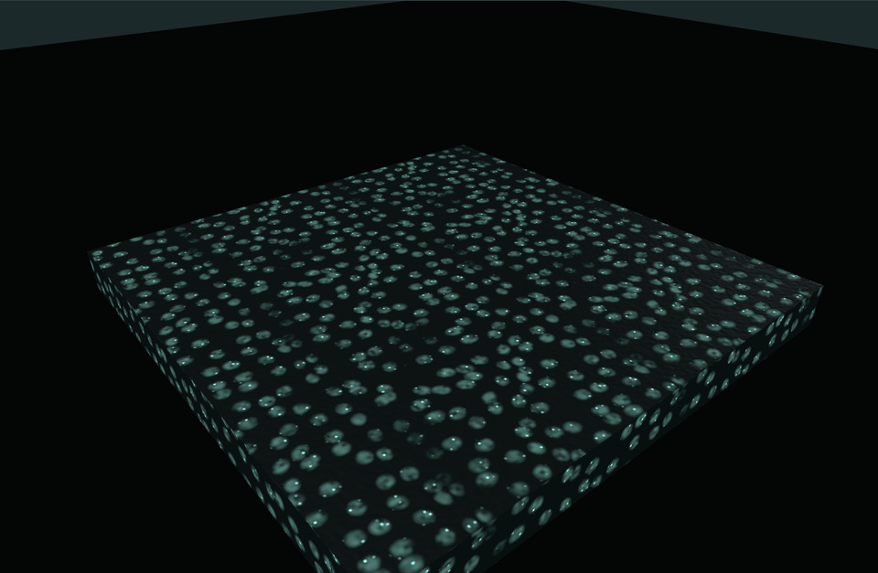

# Gameplay surfaces

These 27 procedural finishes use material details as prompts for hauling, exploration, navigation, and repair. Open **Surfaces → Texture gallery** and choose **Gameplay surfaces**, or search the Library for a swatch by name, family, or a clue such as **iron ore**, **submerged**, or **hindprints**.

Run `npm run dev` on the default port to use the links. The gallery opens under overcast light. The individual swatches open under grazing light, with a dusk setup for glow algae.

[Open the gameplay gallery][gallery]

## On the islands

- **Starter Island** uses the meadow turf across the mainland, compacted gravel on the Harbor Trail, and salt-worn boards on the fishing dock. At Shellglass Tide Pool, look for the barnacles and the low rock whose algae brightens after dusk.
- **Saltwind** has separate magnetite, malachite, and honey calcite stockpiles next to the Slatecliff Mine hopper. From the Tarnstep Survey Shelf, look for lichen at the foot of the benchmark, basalt at the upper falls, and slate downstream.

## Material clues and gameplay ideas

### Ore and crystals

- Follow anomalous compass bearings to a load of dense iron ore. [Magnetite seam][magnetite-seam]
- Compare shallow weathered ore with the richer pockets farther into a quarry. [Malachite bloom][malachite-bloom]
- Deliver a specimen in padded crates and inspect it for bruises on arrival. [Honey calcite][honey-calcite]

### Quarries and ruins

- Pick a dry route across a causeway uncovered at low tide. [Columnar basalt][columnar-basalt]
- Match the bed on two sides of a fault to reconstruct a broken walking route. [Fossil shell bed][fossil-shell-bed]
- Piece together submerged wayfinding markers at successive low tides. [Drowned mosaic][drowned-mosaic]

### Tidal traces

- Read the crust to decide which evaporation pans to rake and which still hold brine. [Salt pan crust][salt-pan-crust]
- Read the high-water mark or scrape enough growth to restore a skiff’s speed. [Barnacle belt][barnacle-belt]
- Follow the strandline after a storm to recover cargo before the tide takes it. [Wrack line][wrack-line]

### Cold ground

- Sound the lake and mark a safe crossing before lending a loaded sled. [Candled lake ice][candled-lake-ice]
- Choose an exposed ridge or sheltered gully according to the weight on your sled. [Wind slab snow][wind-slab-snow]
- Scout where a cart wheel can ride without snagging during spring thaw. [Frost-heaved ground][frost-heaved-ground]

### Living surfaces

- Compare colonies on cairns to infer which stones have been moved since last season. [Lichen clock][lichen-clock]
- Trace where fallen timber has softened and where mushrooms may emerge after a rain. [Mycelium threads][mycelium-threads]
- Follow glowing patches on cave walls as landmarks after dusk. [Glow algae film][glow-algae-film]

### Flood and salvage

- Compare successive rooms to work out which shelf kept its cargo dry. [Watermarked plaster][watermarked-plaster]
- Read which seams reopened to plan a repair before ferrying a heavy load. [Tarred caulking][tarred-caulking]
- Scrape one spot on a salvaged buoy to uncover its original harbor colors. [Salt-blistered paint][salt-blistered-paint]

### Trade and cargo

- Match the pattern to a shipper when paper manifests are soaked through. [Stamped packing clay][stamped-packing-clay]
- Move mats between deck and cart to protect fragile crates and keep them from sliding. [Coir cargo mat][coir-cargo-mat]
- Pick intact wrap when packing food for a crossing in rough weather. [Waxed provision wrap][waxed-provision-wrap]

### Road and tracks

- Decide whether a loaded flatbed can follow old tracks or needs a firmer detour. [Rutted clay][rutted-clay]
- Read the direction of travel to find a hidden gap in the hedgerow. [Hare crossings][hare-crossings]
- Feel for the old track to find a load-bearing crossing through a bog. [Corduroy track][corduroy-track]

### Workshop residues

- Follow debris patterns to distinguish a working forge from a cold storage shed. [Forge scale][forge-scale]
- Sort it from promising ore by weight and texture before committing a cart. [Vesicular slag][vesicular-slag]
- Sweep out a sawpit to reveal usable offcuts and clear a path for the next delivery. [Sawdust drifts][sawdust-drifts]

## Glow algae at dusk

The bluish-green colonies emit their own light in the preview. Increase **Exposure thinning** to see the glowing areas recede. [Open the dusk setup][glow-algae-film]

The recipe definitions contain stable IDs, default wear, and feature spacing in millimetres. Use **Copy setup link** to share a swatch with your own settings and camera. [Gameplay recipes](../src/gameplay-surface-recipes.ts) · [Original surface catalog](surface-catalog.md)

[gallery]: http://localhost:5173/workbench.html#texture-gallery?setup=%7B%22version%22%3A1%2C%22name%22%3A%22Gameplay+surfaces%22%2C%22time%22%3A0%2C%22camera%22%3A%7B%22alpha%22%3A1.5707963267948966%2C%22beta%22%3A0.04%2C%22fov%22%3A0.8%2C%22radius%22%3A10.9%2C%22target%22%3A%5B0%2C0.03%2C0%5D%7D%2C%22options%22%3A%7B%22pattern%22%3A%22gameplay%22%2C%22spacing%22%3A1%7D%2C%22grid%22%3Afalse%2C%22wireframe%22%3Afalse%7D&light=overcast
[magnetite-seam]: http://localhost:5173/workbench.html#magnetite-seam?setup=%7B%22version%22%3A1%2C%22name%22%3A%22Magnetite+seam%22%2C%22time%22%3A0%2C%22camera%22%3A%7B%22alpha%22%3A0.88%2C%22beta%22%3A1.03%2C%22fov%22%3A0.8%2C%22radius%22%3A2.6928%2C%22target%22%3A%5B0%2C0.08772%2C0%5D%7D%2C%22options%22%3A%7B%22spacing%22%3A160%2C%22wear%22%3A0.55%2C%22relief%22%3A1%2C%22tint%22%3A%22%239b8d80%22%7D%2C%22grid%22%3Afalse%2C%22wireframe%22%3Afalse%7D&light=grazing
[malachite-bloom]: http://localhost:5173/workbench.html#malachite-bloom?setup=%7B%22version%22%3A1%2C%22name%22%3A%22Malachite+bloom%22%2C%22time%22%3A0%2C%22camera%22%3A%7B%22alpha%22%3A0.88%2C%22beta%22%3A1.03%2C%22fov%22%3A0.8%2C%22radius%22%3A2.27205%2C%22target%22%3A%5B0%2C0.07401%2C0%5D%7D%2C%22options%22%3A%7B%22spacing%22%3A75%2C%22wear%22%3A0.29%2C%22relief%22%3A1%2C%22tint%22%3A%22%23799554%22%7D%2C%22grid%22%3Afalse%2C%22wireframe%22%3Afalse%7D&light=grazing
[honey-calcite]: http://localhost:5173/workbench.html#honey-calcite?setup=%7B%22version%22%3A1%2C%22name%22%3A%22Honey+calcite%22%2C%22time%22%3A0%2C%22camera%22%3A%7B%22alpha%22%3A0.88%2C%22beta%22%3A1.03%2C%22fov%22%3A0.8%2C%22radius%22%3A2.96208%2C%22target%22%3A%5B0%2C0.09649%2C0%5D%7D%2C%22options%22%3A%7B%22spacing%22%3A110%2C%22wear%22%3A0.3%2C%22relief%22%3A1%2C%22tint%22%3A%22%23d5aa57%22%7D%2C%22grid%22%3Afalse%2C%22wireframe%22%3Afalse%7D&light=grazing
[columnar-basalt]: http://localhost:5173/workbench.html#columnar-basalt?setup=%7B%22version%22%3A1%2C%22name%22%3A%22Columnar+basalt%22%2C%22time%22%3A0%2C%22camera%22%3A%7B%22alpha%22%3A0.88%2C%22beta%22%3A1.03%2C%22fov%22%3A0.8%2C%22radius%22%3A3.168%2C%22target%22%3A%5B0%2C0.1032%2C0%5D%7D%2C%22options%22%3A%7B%22spacing%22%3A430%2C%22wear%22%3A0.46%2C%22relief%22%3A1%2C%22tint%22%3A%22%2361646a%22%7D%2C%22grid%22%3Afalse%2C%22wireframe%22%3Afalse%7D&light=grazing
[fossil-shell-bed]: http://localhost:5173/workbench.html#fossil-shell-bed?setup=%7B%22version%22%3A1%2C%22name%22%3A%22Fossil+shell+bed%22%2C%22time%22%3A0%2C%22camera%22%3A%7B%22alpha%22%3A0.88%2C%22beta%22%3A1.03%2C%22fov%22%3A0.8%2C%22radius%22%3A2.02633%2C%22target%22%3A%5B0%2C0.06601%2C0%5D%7D%2C%22options%22%3A%7B%22spacing%22%3A86%2C%22wear%22%3A0.49%2C%22relief%22%3A1%2C%22tint%22%3A%22%23af9c78%22%7D%2C%22grid%22%3Afalse%2C%22wireframe%22%3Afalse%7D&light=grazing
[drowned-mosaic]: http://localhost:5173/workbench.html#drowned-mosaic?setup=%7B%22version%22%3A1%2C%22name%22%3A%22Drowned+mosaic%22%2C%22time%22%3A0%2C%22camera%22%3A%7B%22alpha%22%3A0.88%2C%22beta%22%3A1.03%2C%22fov%22%3A0.8%2C%22radius%22%3A2.30234%2C%22target%22%3A%5B0%2C0.075%2C0%5D%7D%2C%22options%22%3A%7B%22spacing%22%3A57%2C%22wear%22%3A0.34%2C%22relief%22%3A1%2C%22tint%22%3A%22%234e9d92%22%7D%2C%22grid%22%3Afalse%2C%22wireframe%22%3Afalse%7D&light=grazing
[salt-pan-crust]: http://localhost:5173/workbench.html#salt-pan-crust?setup=%7B%22version%22%3A1%2C%22name%22%3A%22Salt+pan+crust%22%2C%22time%22%3A0%2C%22camera%22%3A%7B%22alpha%22%3A0.88%2C%22beta%22%3A1.03%2C%22fov%22%3A0.8%2C%22radius%22%3A3.168%2C%22target%22%3A%5B0%2C0.1032%2C0%5D%7D%2C%22options%22%3A%7B%22spacing%22%3A155%2C%22wear%22%3A0.54%2C%22relief%22%3A1%2C%22tint%22%3A%22%23c7c8b4%22%7D%2C%22grid%22%3Afalse%2C%22wireframe%22%3Afalse%7D&light=grazing
[barnacle-belt]: http://localhost:5173/workbench.html#barnacle-belt?setup=%7B%22version%22%3A1%2C%22name%22%3A%22Barnacle+belt%22%2C%22time%22%3A0%2C%22camera%22%3A%7B%22alpha%22%3A0.88%2C%22beta%22%3A1.03%2C%22fov%22%3A0.8%2C%22radius%22%3A1.77725%2C%22target%22%3A%5B0%2C0.0579%2C0%5D%7D%2C%22options%22%3A%7B%22spacing%22%3A33%2C%22wear%22%3A0.32%2C%22relief%22%3A1%2C%22tint%22%3A%22%23d2c8ae%22%7D%2C%22grid%22%3Afalse%2C%22wireframe%22%3Afalse%7D&light=grazing
[wrack-line]: http://localhost:5173/workbench.html#wrack-line?setup=%7B%22version%22%3A1%2C%22name%22%3A%22Wrack+line%22%2C%22time%22%3A0%2C%22camera%22%3A%7B%22alpha%22%3A0.88%2C%22beta%22%3A1.03%2C%22fov%22%3A0.8%2C%22radius%22%3A2.1677%2C%22target%22%3A%5B0%2C0.07061%2C0%5D%7D%2C%22options%22%3A%7B%22spacing%22%3A46%2C%22wear%22%3A0.38%2C%22relief%22%3A1%2C%22tint%22%3A%22%23b39860%22%7D%2C%22grid%22%3Afalse%2C%22wireframe%22%3Afalse%7D&light=grazing
[candled-lake-ice]: http://localhost:5173/workbench.html#candled-lake-ice?setup=%7B%22version%22%3A1%2C%22name%22%3A%22Candled+lake+ice%22%2C%22time%22%3A0%2C%22camera%22%3A%7B%22alpha%22%3A0.88%2C%22beta%22%3A1.03%2C%22fov%22%3A0.8%2C%22radius%22%3A3.168%2C%22target%22%3A%5B0%2C0.1032%2C0%5D%7D%2C%22options%22%3A%7B%22spacing%22%3A92%2C%22wear%22%3A0.49%2C%22relief%22%3A1%2C%22tint%22%3A%22%2383aabb%22%7D%2C%22grid%22%3Afalse%2C%22wireframe%22%3Afalse%7D&light=grazing
[wind-slab-snow]: http://localhost:5173/workbench.html#wind-slab-snow?setup=%7B%22version%22%3A1%2C%22name%22%3A%22Wind+slab+snow%22%2C%22time%22%3A0%2C%22camera%22%3A%7B%22alpha%22%3A0.88%2C%22beta%22%3A1.03%2C%22fov%22%3A0.8%2C%22radius%22%3A3.168%2C%22target%22%3A%5B0%2C0.1032%2C0%5D%7D%2C%22options%22%3A%7B%22spacing%22%3A280%2C%22wear%22%3A0.5%2C%22relief%22%3A1%2C%22tint%22%3A%22%23edf1ed%22%7D%2C%22grid%22%3Afalse%2C%22wireframe%22%3Afalse%7D&light=grazing
[frost-heaved-ground]: http://localhost:5173/workbench.html#frost-heaved-ground?setup=%7B%22version%22%3A1%2C%22name%22%3A%22Frost-heaved+ground%22%2C%22time%22%3A0%2C%22camera%22%3A%7B%22alpha%22%3A0.88%2C%22beta%22%3A1.03%2C%22fov%22%3A0.8%2C%22radius%22%3A3.168%2C%22target%22%3A%5B0%2C0.1032%2C0%5D%7D%2C%22options%22%3A%7B%22spacing%22%3A240%2C%22wear%22%3A0.53%2C%22relief%22%3A1%2C%22tint%22%3A%22%239f9b96%22%7D%2C%22grid%22%3Afalse%2C%22wireframe%22%3Afalse%7D&light=grazing
[lichen-clock]: http://localhost:5173/workbench.html#lichen-clock?setup=%7B%22version%22%3A1%2C%22name%22%3A%22Lichen+clock%22%2C%22time%22%3A0%2C%22camera%22%3A%7B%22alpha%22%3A0.88%2C%22beta%22%3A1.03%2C%22fov%22%3A0.8%2C%22radius%22%3A2.33264%2C%22target%22%3A%5B0%2C0.07599%2C0%5D%7D%2C%22options%22%3A%7B%22spacing%22%3A99%2C%22wear%22%3A0.46%2C%22relief%22%3A1%2C%22tint%22%3A%22%23a8a554%22%7D%2C%22grid%22%3Afalse%2C%22wireframe%22%3Afalse%7D&light=grazing
[mycelium-threads]: http://localhost:5173/workbench.html#mycelium-threads?setup=%7B%22version%22%3A1%2C%22name%22%3A%22Mycelium+threads%22%2C%22time%22%3A0%2C%22camera%22%3A%7B%22alpha%22%3A0.88%2C%22beta%22%3A1.03%2C%22fov%22%3A0.8%2C%22radius%22%3A2.42352%2C%22target%22%3A%5B0%2C0.07895%2C0%5D%7D%2C%22options%22%3A%7B%22spacing%22%3A90%2C%22wear%22%3A0.56%2C%22relief%22%3A1%2C%22tint%22%3A%22%23867051%22%7D%2C%22grid%22%3Afalse%2C%22wireframe%22%3Afalse%7D&light=grazing
[glow-algae-film]: http://localhost:5173/workbench.html#glow-algae-film?setup=%7B%22version%22%3A1%2C%22name%22%3A%22Glow+algae+film%22%2C%22time%22%3A0%2C%22camera%22%3A%7B%22alpha%22%3A0.88%2C%22beta%22%3A1.03%2C%22fov%22%3A0.8%2C%22radius%22%3A2.8611%2C%22target%22%3A%5B0%2C0.0932%2C0%5D%7D%2C%22options%22%3A%7B%22spacing%22%3A85%2C%22wear%22%3A0.32%2C%22relief%22%3A1%2C%22tint%22%3A%22%23467a6b%22%7D%2C%22grid%22%3Afalse%2C%22wireframe%22%3Afalse%7D&light=dusk
[watermarked-plaster]: http://localhost:5173/workbench.html#watermarked-plaster?setup=%7B%22version%22%3A1%2C%22name%22%3A%22Watermarked+plaster%22%2C%22time%22%3A0%2C%22camera%22%3A%7B%22alpha%22%3A0.88%2C%22beta%22%3A1.03%2C%22fov%22%3A0.8%2C%22radius%22%3A3.168%2C%22target%22%3A%5B0%2C0.1032%2C0%5D%7D%2C%22options%22%3A%7B%22spacing%22%3A290%2C%22wear%22%3A0.51%2C%22relief%22%3A1%2C%22tint%22%3A%22%23dbcfad%22%7D%2C%22grid%22%3Afalse%2C%22wireframe%22%3Afalse%7D&light=grazing
[tarred-caulking]: http://localhost:5173/workbench.html#tarred-caulking?setup=%7B%22version%22%3A1%2C%22name%22%3A%22Tarred+caulking%22%2C%22time%22%3A0%2C%22camera%22%3A%7B%22alpha%22%3A0.88%2C%22beta%22%3A1.03%2C%22fov%22%3A0.8%2C%22radius%22%3A2.92842%2C%22target%22%3A%5B0%2C0.0954%2C0%5D%7D%2C%22options%22%3A%7B%22spacing%22%3A145%2C%22wear%22%3A0.52%2C%22relief%22%3A1%2C%22tint%22%3A%22%23a4825c%22%7D%2C%22grid%22%3Afalse%2C%22wireframe%22%3Afalse%7D&light=grazing
[salt-blistered-paint]: http://localhost:5173/workbench.html#salt-blistered-paint?setup=%7B%22version%22%3A1%2C%22name%22%3A%22Salt-blistered+paint%22%2C%22time%22%3A0%2C%22camera%22%3A%7B%22alpha%22%3A0.88%2C%22beta%22%3A1.03%2C%22fov%22%3A0.8%2C%22radius%22%3A1.77388%2C%22target%22%3A%5B0%2C0.05779%2C0%5D%7D%2C%22options%22%3A%7B%22spacing%22%3A31%2C%22wear%22%3A0.46%2C%22relief%22%3A1%2C%22tint%22%3A%22%239cb8aa%22%7D%2C%22grid%22%3Afalse%2C%22wireframe%22%3Afalse%7D&light=grazing
[stamped-packing-clay]: http://localhost:5173/workbench.html#stamped-packing-clay?setup=%7B%22version%22%3A1%2C%22name%22%3A%22Stamped+packing+clay%22%2C%22time%22%3A0%2C%22camera%22%3A%7B%22alpha%22%3A0.88%2C%22beta%22%3A1.03%2C%22fov%22%3A0.8%2C%22radius%22%3A1.03%2C%22target%22%3A%5B0%2C0.03355%2C0%5D%7D%2C%22options%22%3A%7B%22spacing%22%3A51%2C%22wear%22%3A0.38%2C%22relief%22%3A1%2C%22tint%22%3A%22%23be8a6b%22%7D%2C%22grid%22%3Afalse%2C%22wireframe%22%3Afalse%7D&light=grazing
[coir-cargo-mat]: http://localhost:5173/workbench.html#coir-cargo-mat?setup=%7B%22version%22%3A1%2C%22name%22%3A%22Coir+cargo+mat%22%2C%22time%22%3A0%2C%22camera%22%3A%7B%22alpha%22%3A0.88%2C%22beta%22%3A1.03%2C%22fov%22%3A0.8%2C%22radius%22%3A1.07712%2C%22target%22%3A%5B0%2C0.03509%2C0%5D%7D%2C%22options%22%3A%7B%22spacing%22%3A16%2C%22wear%22%3A0.45%2C%22relief%22%3A1%2C%22tint%22%3A%22%23b29054%22%7D%2C%22grid%22%3Afalse%2C%22wireframe%22%3Afalse%7D&light=grazing
[waxed-provision-wrap]: http://localhost:5173/workbench.html#waxed-provision-wrap?setup=%7B%22version%22%3A1%2C%22name%22%3A%22Waxed+provision+wrap%22%2C%22time%22%3A0%2C%22camera%22%3A%7B%22alpha%22%3A0.88%2C%22beta%22%3A1.03%2C%22fov%22%3A0.8%2C%22radius%22%3A1.22522%2C%22target%22%3A%5B0%2C0.03991%2C0%5D%7D%2C%22options%22%3A%7B%22spacing%22%3A52%2C%22wear%22%3A0.37%2C%22relief%22%3A1%2C%22tint%22%3A%22%23c9b37c%22%7D%2C%22grid%22%3Afalse%2C%22wireframe%22%3Afalse%7D&light=grazing
[rutted-clay]: http://localhost:5173/workbench.html#rutted-clay?setup=%7B%22version%22%3A1%2C%22name%22%3A%22Rutted+clay%22%2C%22time%22%3A0%2C%22camera%22%3A%7B%22alpha%22%3A0.88%2C%22beta%22%3A1.03%2C%22fov%22%3A0.8%2C%22radius%22%3A3.168%2C%22target%22%3A%5B0%2C0.1032%2C0%5D%7D%2C%22options%22%3A%7B%22spacing%22%3A1450%2C%22wear%22%3A0.58%2C%22relief%22%3A1%2C%22tint%22%3A%22%23a17953%22%7D%2C%22grid%22%3Afalse%2C%22wireframe%22%3Afalse%7D&light=grazing
[hare-crossings]: http://localhost:5173/workbench.html#hare-crossings?setup=%7B%22version%22%3A1%2C%22name%22%3A%22Hare+crossings%22%2C%22time%22%3A0%2C%22camera%22%3A%7B%22alpha%22%3A0.88%2C%22beta%22%3A1.03%2C%22fov%22%3A0.8%2C%22radius%22%3A3.168%2C%22target%22%3A%5B0%2C0.1032%2C0%5D%7D%2C%22options%22%3A%7B%22spacing%22%3A510%2C%22wear%22%3A0.36%2C%22relief%22%3A1%2C%22tint%22%3A%22%23c4b6a0%22%7D%2C%22grid%22%3Afalse%2C%22wireframe%22%3Afalse%7D&light=grazing
[corduroy-track]: http://localhost:5173/workbench.html#corduroy-track?setup=%7B%22version%22%3A1%2C%22name%22%3A%22Corduroy+track%22%2C%22time%22%3A0%2C%22camera%22%3A%7B%22alpha%22%3A0.88%2C%22beta%22%3A1.03%2C%22fov%22%3A0.8%2C%22radius%22%3A3.168%2C%22target%22%3A%5B0%2C0.1032%2C0%5D%7D%2C%22options%22%3A%7B%22spacing%22%3A187%2C%22wear%22%3A0.51%2C%22relief%22%3A1%2C%22tint%22%3A%22%23a08864%22%7D%2C%22grid%22%3Afalse%2C%22wireframe%22%3Afalse%7D&light=grazing
[forge-scale]: http://localhost:5173/workbench.html#forge-scale?setup=%7B%22version%22%3A1%2C%22name%22%3A%22Forge+scale%22%2C%22time%22%3A0%2C%22camera%22%3A%7B%22alpha%22%3A0.88%2C%22beta%22%3A1.03%2C%22fov%22%3A0.8%2C%22radius%22%3A1.54836%2C%22target%22%3A%5B0%2C0.05044%2C0%5D%7D%2C%22options%22%3A%7B%22spacing%22%3A23%2C%22wear%22%3A0.52%2C%22relief%22%3A1%2C%22tint%22%3A%22%23637180%22%7D%2C%22grid%22%3Afalse%2C%22wireframe%22%3Afalse%7D&light=grazing
[vesicular-slag]: http://localhost:5173/workbench.html#vesicular-slag?setup=%7B%22version%22%3A1%2C%22name%22%3A%22Vesicular+slag%22%2C%22time%22%3A0%2C%22camera%22%3A%7B%22alpha%22%3A0.88%2C%22beta%22%3A1.03%2C%22fov%22%3A0.8%2C%22radius%22%3A1.31947%2C%22target%22%3A%5B0%2C0.04298%2C0%5D%7D%2C%22options%22%3A%7B%22spacing%22%3A28%2C%22wear%22%3A0.4%2C%22relief%22%3A1%2C%22tint%22%3A%22%234a7b73%22%7D%2C%22grid%22%3Afalse%2C%22wireframe%22%3Afalse%7D&light=grazing
[sawdust-drifts]: http://localhost:5173/workbench.html#sawdust-drifts?setup=%7B%22version%22%3A1%2C%22name%22%3A%22Sawdust+drifts%22%2C%22time%22%3A0%2C%22camera%22%3A%7B%22alpha%22%3A0.88%2C%22beta%22%3A1.03%2C%22fov%22%3A0.8%2C%22radius%22%3A1.79071%2C%22target%22%3A%5B0%2C0.05833%2C0%5D%7D%2C%22options%22%3A%7B%22spacing%22%3A38%2C%22wear%22%3A0.44%2C%22relief%22%3A1%2C%22tint%22%3A%22%23c29960%22%7D%2C%22grid%22%3Afalse%2C%22wireframe%22%3Afalse%7D&light=grazing
