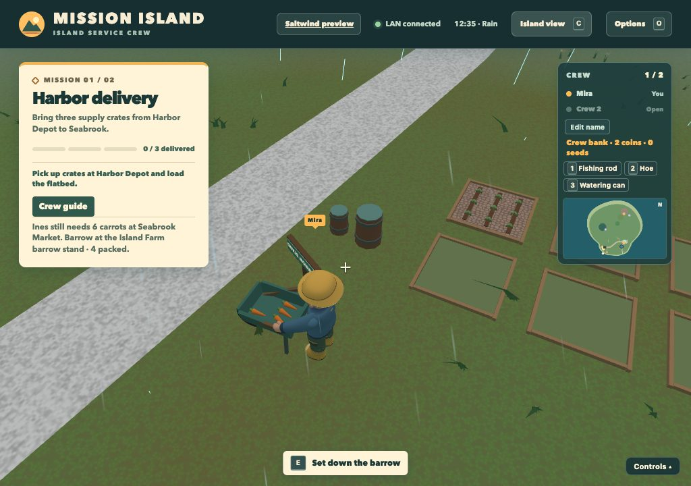

# Farming and the market

The six plots at Island Farm are shared. Each player can work any plot, so one can till or plant while the other waters and harvests.

| Stage | Action |
| --- | --- |
| Grass | Equip the hoe with **2**. Left-click near the plot to till the soil. |
| Tilled | Press **E** near the plot to plant a carrot seed. |
| Planted | Equip the watering can with **3** and left-click to water. |
| Watered | The carrots ripen after 24 seconds of peak daylight on the host. |
| Ripe | Press **E** to harvest one carrot. The plot returns to grass. |

The action uses the nearest plot within about two meters. Each player's cottage chest provides one starter seed. Press **B** at the market awning to buy more for one coin each. Each planting consumes one seed. Watered plots grow during daylight, and rain waters planted plots. The host resolves simultaneous actions in order, so only the first successful harvest of a ripe plot earns a carrot.

Press **E** at the striped awning at Seabrook Market with your hands free of loose cargo. The market sells all fish and carrots in your inventory for 2 and 3 coins each. Each sale deposits its proceeds once in the crew bank.

The clothing counter beside the awning sells individual pieces and the Harbor angler outfit. Purchases use the crew bank and go into the buyer’s own wardrobe. The host checks the buyer’s position, ownership, and the balance before spending any coins. If both players try to buy the three-coin outfit with only three coins left, only the first purchase succeeds.

During a [market order](crew-orders.md), **E** first offers the requested goods up to the remaining amount. The prompt shows how many will go toward the crew order. Press **E** again to sell remaining goods once the order is filled.

## Ines’s produce orders

Read the offer at the **Produce Orders** sign by Ines’s stall, at the west end of the market awning. It shows the crop, quantity, destination, and crew payout before you press **E** to accept. Ines talks about the orders, and her counter is available on ordinary days while she is away as well.

| Order | At the produce counter | Crew reward |
| --- | --- | --- |
| Carrots for Ines | Bring two carrots. Either player can hand in however many they have, up to the remaining quantity. | 8 coins, a shared farming qualification, one barrow, and Island Farm workwear for both wardrobes. |
| Seabrook barrow order | Bring six carrots using the barrow. Either player can pack carrots near the farm. A full barrow takes all six, and Ines also accepts partial barrow loads. | 22 coins. |

One solo player can afford the second seed for the starter order using the two coins from the first delivered harbor crate. Two players can each claim the free seed from their own tool chest. The farm order line in the mission panel shows what Ines still needs and how many carrots are packed.

Collect the barrow at the **Island Farm barrow stand**, just north of the rain barrels. Use **E** to pack, grip, park, or unload as the prompt changes. Once gripping the handles, walk to push it. For a role swap, park it so the other player can grip it. Go east from the stand and turn north along the west side of the market building, then turn east to the produce sign. If the handler disconnects or the host restarts, the barrow returns to the stand with its load. An unattended barrow can also be recovered from the stand.

## Playtest

- Split the crop steps between two players. Inspect the soil and sprouts from both browsers at each stage.
- Let rain water a planted plot and watch it ripen in daylight on both clients. Replant the same plot and check that its next crop starts from zero growth.
- Try harvesting at the same time. The plot yields one carrot total.
- Sell a mixed inventory and verify the total. Press **E** again to check that the finished sale cannot be repeated.
