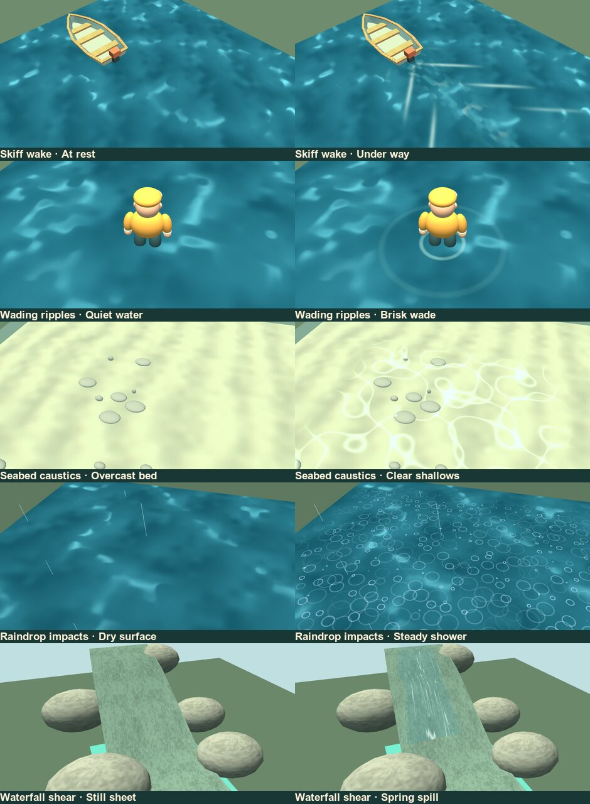
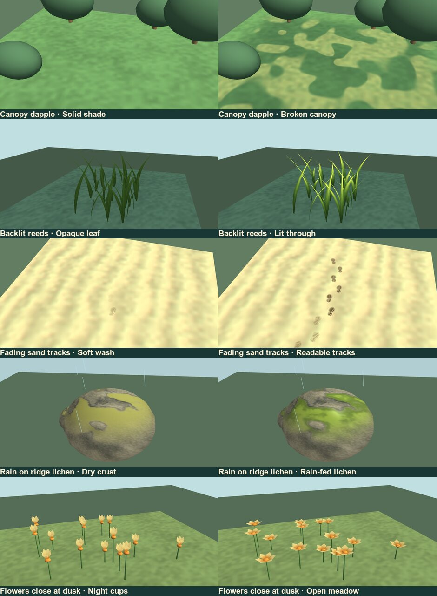
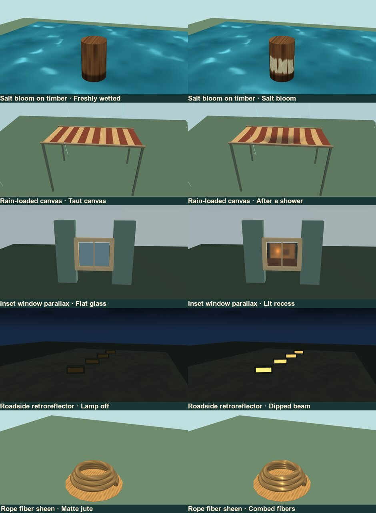
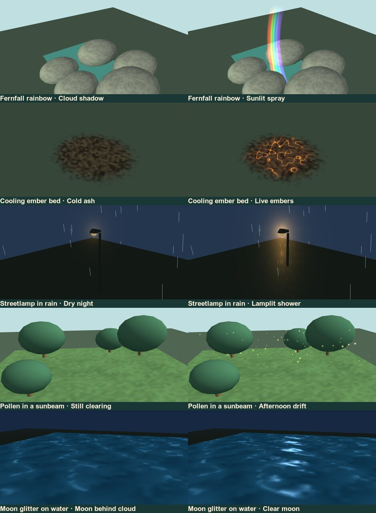
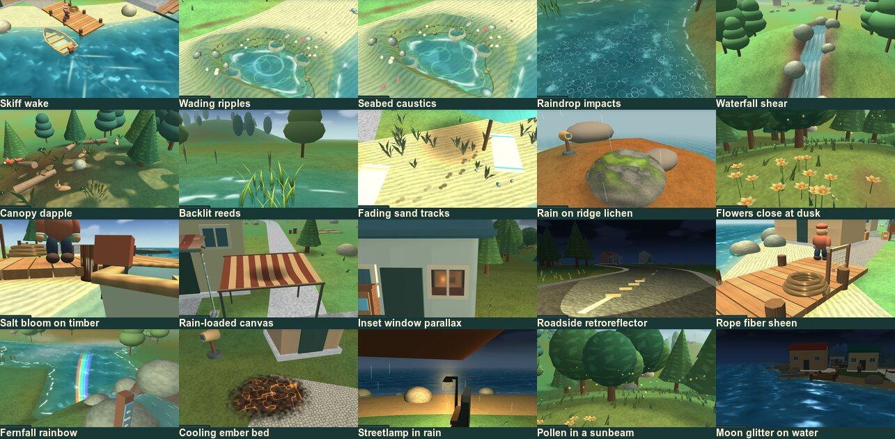

# Twenty more interactive shader studies

Start an isolated Starter Island session from this worktree.

```sh
MISSION_ISLAND_SAVE=more-shaders-trial npm run dev -- --host 127.0.0.1 --port 5248 --strictPort
```

In **Asset Workbench → Surfaces**, open a study, pause, and switch between the two named settings. The studio links below restore a paused frame and its camera. Use **Copy setup link** to preserve a different orbit, setting, or timeline position.

The field links open the same shader at a Starter Island site. **Field view** lists all twenty. The response slider and preset buttons stay on that site and affect the selected shader. Use **Freeze shader time** for a comparison at seven seconds, then drag or scroll to test the camera response. **Live crew** returns to the game clock and gameplay controls. Field shots of the skiff, wader and prints stage the visual input so it can be replayed solo. The live cues use the existing skiff and crew state.

## Water and shore

| Studio setup | Comparison | Game view and live cue |
| --- | --- | --- |
| [Skiff wake][skiff-wake] | **At rest** / **Under way** lengthens the crests and strengthens the center wash. | [Harbor Dock](http://127.0.0.1:5248/?shader-review=skiff-wake) · The wake follows skiff speed and heading. |
| [Wading ripples][wading-rings] | **Quiet water** / **Brisk wade** increases the radiating impulses. | [Shellglass](http://127.0.0.1:5248/?shader-review=wading-rings) · Swim or wade to drive the rings. |
| [Seabed caustics][seabed-caustics] | **Overcast bed** / **Clear shallows** reveals converging light bands on the bed. | [Shellglass](http://127.0.0.1:5248/?shader-review=seabed-caustics) · The light fades in deep water and clouds. |
| [Raindrop impacts][water-rain-rings] | **Dry surface** / **Steady shower** adds independently timed drop rings. | [Mirror Pool](http://127.0.0.1:5248/?shader-review=water-rain-rings) · Live rain controls ring density. |
| [Waterfall shear][waterfall-shear] | **Still sheet** / **Spring spill** shows the center flow pulling ahead of the edges. | [Fernfall](http://127.0.0.1:5248/?shader-review=waterfall-shear) · Rain speeds the spill between the ledges. |



## Vegetation and terrain

| Studio setup | Comparison | Game view and live cue |
| --- | --- | --- |
| [Canopy dapple][canopy-dapple] | **Solid shade** / **Broken canopy** sends moving sunflecks across the floor. | [Juniper Hollow](http://127.0.0.1:5248/?shader-review=canopy-dapple) · Sun direction and clouds change the light beneath the canopy. |
| [Backlit reeds][reed-transmission] | **Opaque leaf** / **Lit through** brightens thin tips when viewed against the sun. | [Mirror Pool](http://127.0.0.1:5248/?shader-review=reed-transmission) · Orbit around the reed bed to change the light path. |
| [Fading sand tracks][sand-footprints] | **Soft wash** / **Readable tracks** retains older heel and toe prints. | [Driftwood Beach](http://127.0.0.1:5248/?shader-review=sand-footprints) · Walk on damp sand. Time and showers erase the trail. |
| [Rain on ridge lichen][ridge-lichen] | **Dry crust** / **Rain-fed lichen** deepens the color of colonies on upward faces. | [Windstone Ridge](http://127.0.0.1:5248/?shader-review=ridge-lichen) · Rain changes color and gloss. |
| [Flowers close at dusk][closing-flowers] | **Night cups** / **Open meadow** folds or opens the petals around fixed stems. | [Meadow slope](http://127.0.0.1:5248/?shader-review=closing-flowers) · Daylight opens the blooms. Rain partly closes them. |



## Built surfaces

| Studio setup | Comparison | Game view and live cue |
| --- | --- | --- |
| [Salt bloom on timber][timber-salt-bloom] | **Freshly wetted** / **Salt bloom** exposes a broken line of dried salt above the water. | [Harbor Dock](http://127.0.0.1:5248/?shader-review=timber-salt-bloom) · Rain suppresses the dry crust on the piling. |
| [Rain-loaded canvas][awning-rain-load] | **Taut canvas** / **After a shower** lowers and darkens the fabric between fixed edges. | [Seabrook Market](http://127.0.0.1:5248/?shader-review=awning-rain-load) · Retained rain loads the side canopy as the shower passes. |
| [Inset window parallax][window-parallax] | **Flat glass** / **Lit recess** separates the glass, a middle layer and the far wall. | [Blue cottage](http://127.0.0.1:5248/?shader-review=window-parallax) · Move sideways in front of the right window. |
| [Roadside retroreflector][road-retroreflector] | **Lamp off** / **Dipped beam** sends light back toward the lamp. | [Harbor Road](http://127.0.0.1:5248/?shader-review=road-retroreflector) · Approach in the flatbed with the headlights lit. Orbit to see the return drop off-axis. |
| [Rope fiber sheen][rope-fiber-sheen] | **Matte jute** / **Combed fibers** stretches the highlight across the twisted rope. | [Harbor Dock](http://127.0.0.1:5248/?shader-review=rope-fiber-sheen) · Look along the coil from the sunlit side. |



## Weather and light

| Studio setup | Comparison | Game view and live cue |
| --- | --- | --- |
| [Fernfall rainbow][fernfall-rainbow] | **Cloud shadow** / **Sunlit spray** reveals colored bands at the antisolar angle. | [Fernfall](http://127.0.0.1:5248/?shader-review=fernfall-rainbow) · Move around the spray with the low sun behind you. |
| [Cooling ember bed][cooling-embers] | **Cold ash** / **Live embers** pushes orange heat through the cracks. | [Forest Lookout](http://127.0.0.1:5248/?shader-review=cooling-embers) · The glowing front shrinks as the fire is suppressed. |
| [Streetlamp in rain][streetlamp-droplets] | **Dry night** / **Lamplit shower** adds directional streaks inside the lamp halo. | [Harbor Road lamps](http://127.0.0.1:5248/?shader-review=streetlamp-droplets) · Lit globes get a halo and rain adds streaks. |
| [Pollen in a sunbeam][meadow-pollen] | **Still clearing** / **Afternoon drift** increases the number of drifting specks. | [Meadow slope](http://127.0.0.1:5248/?shader-review=meadow-pollen) · Motes are clearest late in a dry afternoon. |
| [Moon glitter on water][moon-glitter] | **Moon behind cloud** / **Clear moon** reveals a directional ribbon of wave reflections. | [Harbor Dock](http://127.0.0.1:5248/?shader-review=moon-glitter) · Pull the camera low over the water after dark. |



The [catalog](../src/interactive-shaders/catalog.ts) holds the stable IDs, presets, and framing. Both scenes use the same [water](../src/interactive-shaders/water.ts), [vegetation](../src/interactive-shaders/vegetation.ts), [surface](../src/interactive-shaders/surfaces.ts), and [light](../src/interactive-shaders/light.ts) factories. The [Starter Island bindings](../src/interactive-shaders/island-effects.ts) drive the live responses. The existing [six shader studies](shader-studies.md) retain their original IDs and field views.



## Frame timing example

At Mirror Pool in the rain-impact view, freeze shader time and use **Measure frame time**. Switch off just the raindrop response with **Dry surface**, restore **Steady shower** in Full, and then measure it in Reduced. Reduced checks the five closest grid cells and shortens the maximum ring radius. Full checks nine.

These timings use headless Brave Chromium 157 with hardware WebGL 2 via ANGLE Metal on an Apple M1 Pro. The rendered viewport is 1440 × 828, at the reset Mirror Pool camera with one connected crew member. Each run warms up for 45 frames and samples 120. Each number is the median of three runs for that percentile, in milliseconds. The GPU measurements cover the whole scene and varied across samples.

| Rain response | Frame interval p50 / p95 | CPU render p50 / p95 | GPU p50 / p95 |
| --- | ---: | ---: | ---: |
| Dry surface, Full quality | 16.60 / 17.60 | 1.80 / 2.00 | 12.97 / 17.47 |
| Steady shower, Full | 16.70 / 17.40 | 1.70 / 2.10 | 9.98 / 20.22 |
| Steady shower, Reduced | 16.70 / 17.50 | 1.80 / 2.00 | 9.63 / 18.21 |

[skiff-wake]: http://127.0.0.1:5248/workbench.html#skiff-wake?setup=%7B%22version%22%3A1%2C%22name%22%3A%22Skiff+wake%22%2C%22camera%22%3A%7B%22alpha%22%3A-2.33%2C%22beta%22%3A0.73%2C%22radius%22%3A13%2C%22fov%22%3A0.8%2C%22target%22%3A%5B0%2C0.14%2C0%5D%7D%2C%22time%22%3A7%2C%22options%22%3A%7B%22response%22%3A0.82%7D%2C%22grid%22%3Afalse%2C%22wireframe%22%3Afalse%7D&light=daylight
[wading-rings]: http://127.0.0.1:5248/workbench.html#wading-rings?setup=%7B%22version%22%3A1%2C%22name%22%3A%22Wading+ripples%22%2C%22camera%22%3A%7B%22alpha%22%3A-1.3%2C%22beta%22%3A0.78%2C%22radius%22%3A6%2C%22fov%22%3A0.8%2C%22target%22%3A%5B0%2C0.14%2C0%5D%7D%2C%22time%22%3A4.48%2C%22options%22%3A%7B%22response%22%3A0.84%7D%2C%22grid%22%3Afalse%2C%22wireframe%22%3Afalse%7D&light=daylight
[seabed-caustics]: http://127.0.0.1:5248/workbench.html#seabed-caustics?setup=%7B%22version%22%3A1%2C%22name%22%3A%22Seabed+caustics%22%2C%22camera%22%3A%7B%22alpha%22%3A-1.3%2C%22beta%22%3A0.76%2C%22radius%22%3A6%2C%22fov%22%3A0.8%2C%22target%22%3A%5B0%2C0.14%2C0%5D%7D%2C%22time%22%3A7%2C%22options%22%3A%7B%22response%22%3A0.87%7D%2C%22grid%22%3Afalse%2C%22wireframe%22%3Afalse%7D&light=daylight
[water-rain-rings]: http://127.0.0.1:5248/workbench.html#water-rain-rings?setup=%7B%22version%22%3A1%2C%22name%22%3A%22Raindrop+impacts%22%2C%22camera%22%3A%7B%22alpha%22%3A-1.3%2C%22beta%22%3A0.85%2C%22radius%22%3A8%2C%22fov%22%3A0.8%2C%22target%22%3A%5B0%2C0.14%2C0%5D%7D%2C%22time%22%3A7%2C%22options%22%3A%7B%22response%22%3A0.8%7D%2C%22grid%22%3Afalse%2C%22wireframe%22%3Afalse%7D&light=daylight
[waterfall-shear]: http://127.0.0.1:5248/workbench.html#waterfall-shear?setup=%7B%22version%22%3A1%2C%22name%22%3A%22Waterfall+shear%22%2C%22camera%22%3A%7B%22alpha%22%3A1.23%2C%22beta%22%3A1.03%2C%22radius%22%3A8.8%2C%22fov%22%3A0.8%2C%22target%22%3A%5B0%2C1.45%2C0%5D%7D%2C%22time%22%3A7%2C%22options%22%3A%7B%22response%22%3A0.85%7D%2C%22grid%22%3Afalse%2C%22wireframe%22%3Afalse%7D&light=daylight
[canopy-dapple]: http://127.0.0.1:5248/workbench.html#canopy-dapple?setup=%7B%22version%22%3A1%2C%22name%22%3A%22Canopy+dapple%22%2C%22camera%22%3A%7B%22alpha%22%3A-1.3%2C%22beta%22%3A0.9%2C%22radius%22%3A7.3%2C%22fov%22%3A0.8%2C%22target%22%3A%5B0%2C0.14%2C0%5D%7D%2C%22time%22%3A7%2C%22options%22%3A%7B%22response%22%3A0.86%7D%2C%22grid%22%3Afalse%2C%22wireframe%22%3Afalse%7D&light=daylight
[reed-transmission]: http://127.0.0.1:5248/workbench.html#reed-transmission?setup=%7B%22version%22%3A1%2C%22name%22%3A%22Backlit+reeds%22%2C%22camera%22%3A%7B%22alpha%22%3A0.3%2C%22beta%22%3A1.24%2C%22radius%22%3A5%2C%22fov%22%3A0.8%2C%22target%22%3A%5B0%2C0.63%2C0%5D%7D%2C%22time%22%3A7%2C%22options%22%3A%7B%22response%22%3A0.92%7D%2C%22grid%22%3Afalse%2C%22wireframe%22%3Afalse%7D&light=daylight
[sand-footprints]: http://127.0.0.1:5248/workbench.html#sand-footprints?setup=%7B%22version%22%3A1%2C%22name%22%3A%22Fading+sand+tracks%22%2C%22camera%22%3A%7B%22alpha%22%3A-1.3%2C%22beta%22%3A0.68%2C%22radius%22%3A5.8%2C%22fov%22%3A0.8%2C%22target%22%3A%5B0%2C0.14%2C0%5D%7D%2C%22time%22%3A7%2C%22options%22%3A%7B%22response%22%3A0.9%7D%2C%22grid%22%3Afalse%2C%22wireframe%22%3Afalse%7D&light=daylight
[ridge-lichen]: http://127.0.0.1:5248/workbench.html#ridge-lichen?setup=%7B%22version%22%3A1%2C%22name%22%3A%22Rain+on+ridge+lichen%22%2C%22camera%22%3A%7B%22alpha%22%3A-1.48%2C%22beta%22%3A1.04%2C%22radius%22%3A5.45%2C%22fov%22%3A0.8%2C%22target%22%3A%5B0%2C0.94%2C0%5D%7D%2C%22time%22%3A7%2C%22options%22%3A%7B%22response%22%3A0.9%7D%2C%22grid%22%3Afalse%2C%22wireframe%22%3Afalse%7D&light=daylight
[closing-flowers]: http://127.0.0.1:5248/workbench.html#closing-flowers?setup=%7B%22version%22%3A1%2C%22name%22%3A%22Flowers+close+at+dusk%22%2C%22camera%22%3A%7B%22alpha%22%3A-1.9%2C%22beta%22%3A1.12%2C%22radius%22%3A4.35%2C%22fov%22%3A0.8%2C%22target%22%3A%5B0%2C0.45%2C0%5D%7D%2C%22time%22%3A7%2C%22options%22%3A%7B%22response%22%3A0.92%7D%2C%22grid%22%3Afalse%2C%22wireframe%22%3Afalse%7D&light=daylight
[timber-salt-bloom]: http://127.0.0.1:5248/workbench.html#timber-salt-bloom?setup=%7B%22version%22%3A1%2C%22name%22%3A%22Salt+bloom+on+timber%22%2C%22camera%22%3A%7B%22alpha%22%3A-1.3%2C%22beta%22%3A1.17%2C%22radius%22%3A4.4%2C%22fov%22%3A0.8%2C%22target%22%3A%5B0%2C0.83%2C0%5D%7D%2C%22time%22%3A7%2C%22options%22%3A%7B%22response%22%3A0.9%7D%2C%22grid%22%3Afalse%2C%22wireframe%22%3Afalse%7D&light=daylight
[awning-rain-load]: http://127.0.0.1:5248/workbench.html#awning-rain-load?setup=%7B%22version%22%3A1%2C%22name%22%3A%22Rain-loaded+canvas%22%2C%22camera%22%3A%7B%22alpha%22%3A-1.5%2C%22beta%22%3A0.96%2C%22radius%22%3A6.5%2C%22fov%22%3A0.8%2C%22target%22%3A%5B0%2C1.35%2C0%5D%7D%2C%22time%22%3A7%2C%22options%22%3A%7B%22response%22%3A0.89%7D%2C%22grid%22%3Afalse%2C%22wireframe%22%3Afalse%7D&light=daylight
[window-parallax]: http://127.0.0.1:5248/workbench.html#window-parallax?setup=%7B%22version%22%3A1%2C%22name%22%3A%22Inset+window+parallax%22%2C%22camera%22%3A%7B%22alpha%22%3A-1.5%2C%22beta%22%3A1.28%2C%22radius%22%3A4.9%2C%22fov%22%3A0.8%2C%22target%22%3A%5B0%2C1.31%2C0%5D%7D%2C%22time%22%3A7%2C%22options%22%3A%7B%22response%22%3A0.83%7D%2C%22grid%22%3Afalse%2C%22wireframe%22%3Afalse%7D&light=daylight
[road-retroreflector]: http://127.0.0.1:5248/workbench.html#road-retroreflector?setup=%7B%22version%22%3A1%2C%22name%22%3A%22Roadside+retroreflector%22%2C%22camera%22%3A%7B%22alpha%22%3A-2.78%2C%22beta%22%3A1.4%2C%22radius%22%3A4.7%2C%22fov%22%3A0.8%2C%22target%22%3A%5B0%2C0.18%2C0%5D%7D%2C%22time%22%3A7%2C%22options%22%3A%7B%22response%22%3A0.94%7D%2C%22grid%22%3Afalse%2C%22wireframe%22%3Afalse%7D&light=daylight
[rope-fiber-sheen]: http://127.0.0.1:5248/workbench.html#rope-fiber-sheen?setup=%7B%22version%22%3A1%2C%22name%22%3A%22Rope+fiber+sheen%22%2C%22camera%22%3A%7B%22alpha%22%3A-1.15%2C%22beta%22%3A1.08%2C%22radius%22%3A4.3%2C%22fov%22%3A0.8%2C%22target%22%3A%5B0%2C0.73%2C0%5D%7D%2C%22time%22%3A7%2C%22options%22%3A%7B%22response%22%3A0.92%7D%2C%22grid%22%3Afalse%2C%22wireframe%22%3Afalse%7D&light=daylight
[fernfall-rainbow]: http://127.0.0.1:5248/workbench.html#fernfall-rainbow?setup=%7B%22version%22%3A1%2C%22name%22%3A%22Fernfall+rainbow%22%2C%22camera%22%3A%7B%22alpha%22%3A-2.17%2C%22beta%22%3A1.02%2C%22radius%22%3A9.25%2C%22fov%22%3A0.8%2C%22target%22%3A%5B0%2C1.9%2C0%5D%7D%2C%22time%22%3A7%2C%22options%22%3A%7B%22response%22%3A0.91%7D%2C%22grid%22%3Afalse%2C%22wireframe%22%3Afalse%7D&light=daylight
[cooling-embers]: http://127.0.0.1:5248/workbench.html#cooling-embers?setup=%7B%22version%22%3A1%2C%22name%22%3A%22Cooling+ember+bed%22%2C%22camera%22%3A%7B%22alpha%22%3A-1.3%2C%22beta%22%3A0.8%2C%22radius%22%3A5.65%2C%22fov%22%3A0.8%2C%22target%22%3A%5B0%2C0.14%2C0%5D%7D%2C%22time%22%3A7%2C%22options%22%3A%7B%22response%22%3A0.88%7D%2C%22grid%22%3Afalse%2C%22wireframe%22%3Afalse%7D&light=daylight
[streetlamp-droplets]: http://127.0.0.1:5248/workbench.html#streetlamp-droplets?setup=%7B%22version%22%3A1%2C%22name%22%3A%22Streetlamp+in+rain%22%2C%22camera%22%3A%7B%22alpha%22%3A-0.8%2C%22beta%22%3A1.22%2C%22radius%22%3A6.2%2C%22fov%22%3A0.8%2C%22target%22%3A%5B0%2C1.7%2C0%5D%7D%2C%22time%22%3A7%2C%22options%22%3A%7B%22response%22%3A0.89%7D%2C%22grid%22%3Afalse%2C%22wireframe%22%3Afalse%7D&light=daylight
[meadow-pollen]: http://127.0.0.1:5248/workbench.html#meadow-pollen?setup=%7B%22version%22%3A1%2C%22name%22%3A%22Pollen+in+a+sunbeam%22%2C%22camera%22%3A%7B%22alpha%22%3A-1.7%2C%22beta%22%3A1.22%2C%22radius%22%3A7.9%2C%22fov%22%3A0.8%2C%22target%22%3A%5B0%2C0.82%2C0%5D%7D%2C%22time%22%3A7%2C%22options%22%3A%7B%22response%22%3A0.9%7D%2C%22grid%22%3Afalse%2C%22wireframe%22%3Afalse%7D&light=daylight
[moon-glitter]: http://127.0.0.1:5248/workbench.html#moon-glitter?setup=%7B%22version%22%3A1%2C%22name%22%3A%22Moon+glitter+on+water%22%2C%22camera%22%3A%7B%22alpha%22%3A-1.28%2C%22beta%22%3A1.27%2C%22radius%22%3A11.3%2C%22fov%22%3A0.8%2C%22target%22%3A%5B0%2C0.11%2C0%5D%7D%2C%22time%22%3A7%2C%22options%22%3A%7B%22response%22%3A0.93%7D%2C%22grid%22%3Afalse%2C%22wireframe%22%3Afalse%7D&light=daylight
