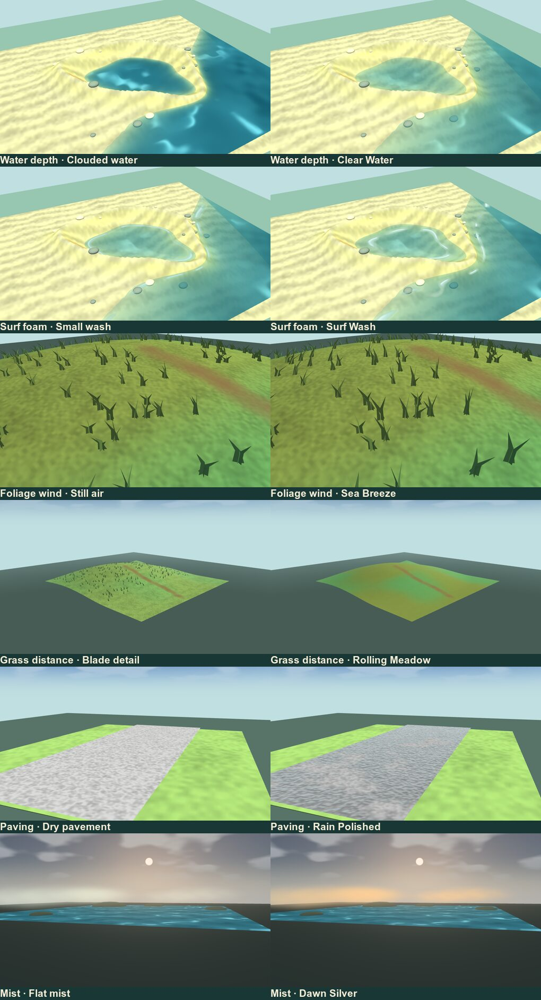
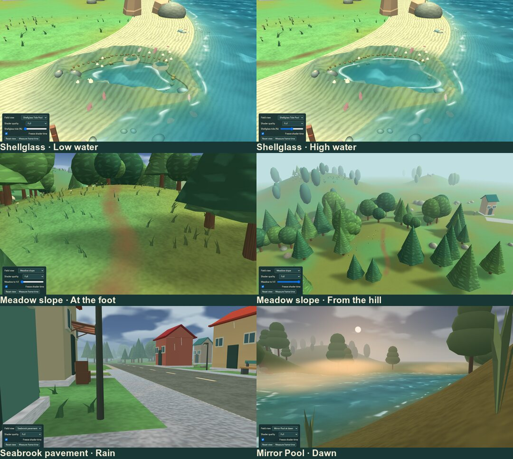

# Interactive shader studies

Run `MISSION_ISLAND_SAVE=shader-review npm run dev` and open **Surfaces** in the [Asset Workbench](http://localhost:5173/workbench.html). The links below restore a paused Workbench view and the game’s named preset. Use the two comparison buttons in **Asset settings** to switch at the same camera and frame. Play or scrub for motion, and use **Copy setup link** to share your own version. For a remote reviewer, open the same paths using the development host’s LAN address.

## Library

Before this work, **Shader drafts** staged nine editable substance looks. Its separate **Water** entry animated open-water ripples and omitted shoreline effects in the studio. Starter Island already had coast-radius tint and breakers, static grass tufts over a grass texture, dry concrete paving, and dawn mist with time and weather gating. The studies below extend those production behaviors and register each distinct response once.

| Group and study | Preset and comparison settings | Source and example |
| --- | --- | --- |
| Water and shore · [Shallow water depth][shallow-water] | **Clouded water** (clarity 0.25) / **Clear Water** (1.35). Keep the camera still and compare the basin floor and its shallow ledges. | [Ocean material](../src/ocean.ts) and [seabed depth](../src/shore-depth.ts), Shellglass Tide Pool |
| Water and shore · [Shoreline surf foam][surf-foam] | **Small wash** (0.12 m) / **Surf Wash** (0.34 m). Play the loop to see the foam reach over the sill and break up on retreat. | [Ocean material](../src/ocean.ts), Shellglass’s seaward sill |
| Vegetation and terrain · [Rooted foliage wind][foliage-wind] | **Still air** (0) / **Sea Breeze** (0.65). Scrub to a second time and watch the tip move around its stationary stem. | [Meadow blades](../src/meadow-shaders.ts), meadow slope above Harbor Road |
| Vegetation and terrain · [Meadow grass distance blend][meadow-distance] | **Blade detail** (65 m fade end, 0.10 contrast) / **Rolling Meadow** (26 m, 0.32). Zoom from blades to patches while keeping the path in view. | [Meadow surface and blades](../src/meadow-shaders.ts), Meadow slope path |
| Weather and light · [Rain-darkened paving][rain-paving] | **Dry pavement** (0 wetness) / **Rain Polished** (1 wetness, 0.72 reflection). Orbit low along the pavement and look for the reflection breaking across dry pores. | [Wet paving](../src/wet-paving.ts), Seabrook sidewalks |
| Weather and light · [Low-angle light in mist][dawn-mist] | **Flat mist** (0 scattering) / **Dawn Silver** (1.5) at hour 6.6. Orbit away from the dawn sun, then change the hour to see the bank thin. Use **Mist layers** to compare full and reduced detail. | [Local phenomena](../src/island-phenomena.ts), Mirror Pool |

[Named presets](../src/shader-studies.ts) and [Workbench entries](../src/workbench/shader-studies.ts) contain the reusable settings, comparison values and preview factories.

## Starter Island field review

Open a field link on the running game host. Drag to orbit and scroll to zoom. **Freeze shader time** holds the shader clock at seven seconds. Switch **Shader quality** between **Off (baseline)** and **Full** at the same pose. Off restores the previous ocean and tidal-wash rendering, flat mist, dry paving and static blade appearance in the current scene. **Live crew** returns the controls to the player and uses the shared game clock and weather.

1. [Shellglass Tide Pool](http://localhost:5173/?shader-review=shore) at 11:30 in dry weather. Start at the dry rim, orbit across the seaward sill, and compare a still frame and the moving wash. Scrub **Shellglass tide (%)** from 0 to 50 and then 75 to compare low, high and retreating wash with the camera fixed. Check that the foam follows the active water level and stays aligned with the lip as the camera moves. Use **Reduced** to keep depth and foam with fewer wave noise evaluations.
2. [Meadow slope](http://localhost:5173/?shader-review=meadow) at 15:00 in dry weather. Start at the foot of the path, move **Meadow to hill** to the end, then pull back with the wheel until the blades give way to patches. Reverse the move to look for shimmer, sliding or a disappearing path. To walk it as the crew, select **Live crew**, go to the meadow north of Harbor Road at X −26 m, Z 12 m, and follow the worn path toward X −25 m, Z 23 m.
3. [Seabrook pavement](http://localhost:5173/?shader-review=paving) at 12:00 with rain intensity 0.65. Compare on and off from the low camera, then orbit overhead. The sky reflection should change with angle and stay broken by the same world-space patches. In live play, stored rain continues darkening the paving as the storm clears.
4. [Mirror Pool at dawn](http://localhost:5173/?shader-review=mist) at 06:36. Orbit toward and away from the sun. Check that the low-angle highlight softens off-axis and the bank leaves landmarks legible. Try **Reduced** for a six-layer mist bank. In live play, the existing dawn and rain gates still control the mist.

The Shellglass wash shader uses the height from the shared 2.55-day tide cycle to shade the raised surface and attenuates the foam underneath it. The Workbench basin samples keep the plane at ocean level for a controlled comparison. [Shellglass tide and saved views](shellglass-tide-pool.md) · [Tide-pool issue #41](https://github.com/brylie/mission-island/issues/41)

Mirror Pool uses the existing local phenomenon and the island’s sun direction, time and rain. Fernfall spray and the three retained-pool glows keep their own settings. [Local phenomena #31](https://github.com/brylie/mission-island/issues/31)

The field pass included a Shellglass orbit at the same animation time, low and high water, and a zoom out over the meadow path. The foam followed the raised wash, distant blades faded into stationary patches, and the path stayed visible. A separate live-crew walk climbed from about 0.35 m to 2.41 m elevation under normal movement controls.

## Frame timings

MacBook Pro with Apple M1 Pro (10 CPU cores, 16 GPU cores, 32 GB), macOS 27.0.1, Brave Chromium 157 in headless mode with hardware WebGL 2 via ANGLE Metal. The game drew at **1440 × 828** with a 60 Hz frame cadence, one connected crew member in an isolated save, each site at its reset camera, and the shader clock held at 7 seconds. Shellglass was at 32% of its tide cycle. The captures and timings use the Shellglass tide build as the scene baseline.

**Measure frame time** waits 45 frames and records the next 120. Each table cell gives the median of three runs for each percentile, in milliseconds. Frame interval includes the browser’s cadence, CPU render measures the wall time inside Babylon’s scene render, and GPU uses the WebGL timer query when available. These are whole-scene measurements.

| Scene | Quality | Frame interval p50 / p95 | CPU render p50 / p95 | GPU p50 / p95 |
| --- | --- | ---: | ---: | ---: |
| Shellglass Tide Pool | Off | 16.70 / 16.80 | 2.20 / 2.60 | 9.19 / 10.97 |
| Shellglass Tide Pool | Reduced | 16.70 / 16.80 | 2.70 / 3.10 | 8.87 / 10.88 |
| Shellglass Tide Pool | Full | 16.70 / 16.80 | 2.30 / 2.60 | 9.23 / 9.83 |
| Meadow slope | Off | 16.70 / 17.40 | 2.10 / 2.50 | 7.61 / 10.87 |
| Meadow slope | Full | 16.70 / 17.40 | 2.20 / 2.60 | 7.22 / 10.93 |
| Seabrook paving | Off | 16.70 / 17.40 | 3.30 / 3.70 | 5.29 / 9.88 |
| Seabrook paving | Full | 16.70 / 17.50 | 3.10 / 3.60 | 5.15 / 8.94 |
| Mirror Pool | Off | 16.70 / 17.30 | 2.50 / 2.80 | 7.53 / 11.78 |
| Mirror Pool | Reduced | 16.60 / 17.30 | 2.60 / 2.90 | 6.87 / 11.48 |
| Mirror Pool | Full | 16.70 / 17.50 | 2.50 / 3.00 | 7.73 / 11.48 |

**Reduced** reuses the swell for chop and drops the broad gust noise at Shellglass, retaining depth, tide height and the foam front. At Mirror Pool it draws six mist layers instead of nine and retains the scattering response. Tail timings varied across runs, and all four scenes had a roughly 16.7 ms median frame interval.

[shallow-water]: http://localhost:5173/workbench.html#shallow-water?setup=%7B%22version%22%3A1%2C%22name%22%3A%22Shallow+water+depth%22%2C%22camera%22%3A%7B%22alpha%22%3A-2.04%2C%22beta%22%3A0.94%2C%22radius%22%3A9.2%2C%22fov%22%3A0.8%2C%22target%22%3A%5B46%2C-0.065%2C-33%5D%7D%2C%22time%22%3A4.8%2C%22options%22%3A%7B%22clarity%22%3A1.35%2C%22quality%22%3A%22full%22%7D%2C%22grid%22%3Afalse%2C%22wireframe%22%3Afalse%7D&light=daylight
[surf-foam]: http://localhost:5173/workbench.html#surf-foam?setup=%7B%22version%22%3A1%2C%22name%22%3A%22Shoreline+surf+foam%22%2C%22camera%22%3A%7B%22alpha%22%3A-2.04%2C%22beta%22%3A0.94%2C%22radius%22%3A9.2%2C%22fov%22%3A0.8%2C%22target%22%3A%5B46%2C-0.065%2C-33%5D%7D%2C%22time%22%3A7%2C%22options%22%3A%7B%22foamReach%22%3A0.34%2C%22quality%22%3A%22full%22%7D%2C%22grid%22%3Afalse%2C%22wireframe%22%3Afalse%7D&light=daylight
[foliage-wind]: http://localhost:5173/workbench.html#foliage-wind?setup=%7B%22version%22%3A1%2C%22name%22%3A%22Rooted+foliage+wind%22%2C%22camera%22%3A%7B%22alpha%22%3A-2.37%2C%22beta%22%3A1.15%2C%22radius%22%3A4.4%2C%22fov%22%3A0.8%2C%22target%22%3A%5B-29%2C2.0246%2C19%5D%7D%2C%22time%22%3A7%2C%22options%22%3A%7B%22gust%22%3A0.65%7D%2C%22grid%22%3Afalse%2C%22wireframe%22%3Afalse%7D&light=daylight
[meadow-distance]: http://localhost:5173/workbench.html#meadow-distance?setup=%7B%22version%22%3A1%2C%22name%22%3A%22Meadow+grass+distance+blend%22%2C%22camera%22%3A%7B%22alpha%22%3A-2.37%2C%22beta%22%3A1.34%2C%22radius%22%3A39.2056%2C%22fov%22%3A0.8%2C%22target%22%3A%5B-25%2C1.2228%2C19.5966%5D%7D%2C%22time%22%3A7%2C%22options%22%3A%7B%22grassDistance%22%3A26%2C%22patchContrast%22%3A0.32%7D%2C%22grid%22%3Afalse%2C%22wireframe%22%3Afalse%7D&light=daylight
[rain-paving]: http://localhost:5173/workbench.html#rain-paving?setup=%7B%22version%22%3A1%2C%22name%22%3A%22Rain-darkened+paving%22%2C%22camera%22%3A%7B%22alpha%22%3A-2.78%2C%22beta%22%3A1.37%2C%22radius%22%3A7.5%2C%22fov%22%3A0.8%2C%22target%22%3A%5B0%2C0.172%2C0%5D%7D%2C%22time%22%3A0%2C%22options%22%3A%7B%22wetness%22%3A1%2C%22reflection%22%3A0.72%7D%2C%22grid%22%3Afalse%2C%22wireframe%22%3Afalse%7D&light=daylight
[dawn-mist]: http://localhost:5173/workbench.html#dawn-mist?setup=%7B%22version%22%3A1%2C%22name%22%3A%22Low-angle+light+in+mist%22%2C%22camera%22%3A%7B%22alpha%22%3A0.3%2C%22beta%22%3A1.52%2C%22radius%22%3A23%2C%22fov%22%3A0.8%2C%22target%22%3A%5B0%2C0.2883%2C0%5D%7D%2C%22time%22%3A7%2C%22options%22%3A%7B%22hour%22%3A6.6%2C%22mistDensity%22%3A1%2C%22scattering%22%3A1.5%7D%2C%22grid%22%3Afalse%2C%22wireframe%22%3Afalse%7D&light=daylight
