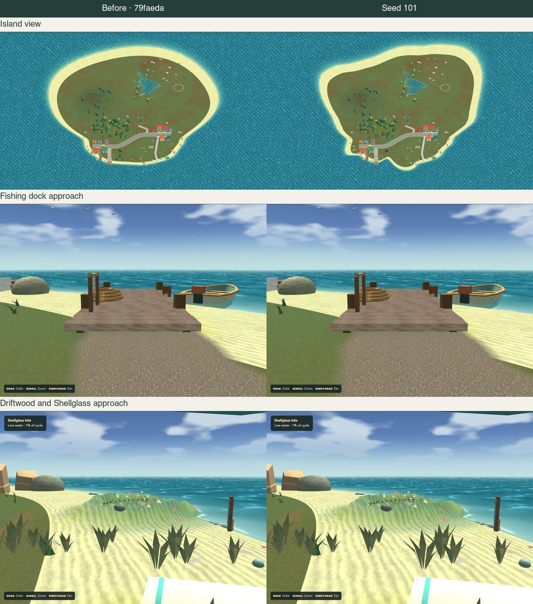

# Starter Island coastline

From Island view, look for the bite in the south coast beside the harbor, the point beyond Windstone Ridge, and a quieter strand from Driftwood Beach toward Shellglass. At shore level, the harbor still has a dry approach to the fishing dock and a separate road to the closed ferry terminal. At Driftwood, follow the sand past the tide pool to the Splitstone cleft.

The cove sits on the south edge and the Windstone point on the northeast edge. Both Island views are in clear daylight, at 13:39 before and 13:21 after. Both shore-level pairs use the same camera settings and clear daylight at 13:00.

## Coast controls

The [Starter Island coast definition](../src/worlds/starter/coastline.ts) uses seed **101**. It measures distance along the surveyed shoreline so each feature and noise band has a consistent scale in metres. Bearings locate the centres in the terrain mesh's angular coordinates. Zero points east and 90 points north. Displacements are measured along the ray from the island origin. Positive values extend the shore seaward. Each displacement eases to zero over its half-width in each direction.

| Landform | Centre bearing | Half-width | Displacement |
| --- | ---: | ---: | ---: |
| Outer harbor shoulder | 210° | 34 m | +12 m |
| Harbor cove | 248° | 30 m | −9 m |
| Southern shoulder | 275° | 29 m | +11 m |
| Windstone point | 70° | 65 m | +24 m |
| Windstone east flank | 43° | 53 m | −14 m |
| Windstone west flank | 100° | 70 m | −12 m |
| Northwestern indentation | 142° | 76 m | −15 m |

The [shared noise functions](../src/math/noise.ts) layer periodic, centered value noise at target wavelengths of 64, 24, and 9 m with maximum displacements of 4.2, 1.6, and 0.45 m. Each wavelength is rounded to a whole number of intervals around the island so the field joins at the seam. The harbor shelf is fixed for 13 m on either side of bearing 231°, then transitions over 9 m. The quiet Driftwood–Shellglass shelf is fixed for 21 m on either side of bearing 314°, then transitions over 13 m.

The terrain, maps, depth texture and host sample the same contour. The skiff boundary remains 75 m farther out along each ray. The 24 visible buoys and the map boundary both use the same limit as the host's hull checks. A returning player inside the boundary can resume as a swimmer if the shore moved under them. The host moves an on-foot player outside the new boundary to their cottage and returns a stranded skiff to its harbor launch.

## Repeat the field check

1. Open the game in Island view and look south toward the harbor curve and north toward the Windstone point. Switch to the follow camera and walk Harbor Depot → fishing dock. Check that the plank approach and boarding work and that the skiff can paddle out and turn back from the buoy limit. Walk the road to the closed ferry terminal as a separate approach.
2. Follow Driftwood Beach → Shellglass → Splitstone. Check the water's edge, the dry route around the sill, and the two discoveries. Use the [harbor view](http://localhost:5173/workbench.html?view=1&focus=-44,-33.5&target=-44,0.1,-33.5&orbit=1.57,1.42,10.4,0.8&sky=13,0,8&display=0,0#landscape) and [Driftwood view](http://localhost:5173/workbench.html?view=1&focus=45.3,-32.8&target=45.3,0.12,-32.8&orbit=-2.95,1.42,9.2,0.8&sky=13,0,8&display=0,0#landscape) for matching shore-level captures at 13:00 in clear daylight.
3. Restart the host and reopen the same views. Record the build, seed, positions, and any difference in shoreline or buoys in the shared [Island silhouette and terrain checklist](https://github.com/brylie/mission-island/issues/52#issue-body).
