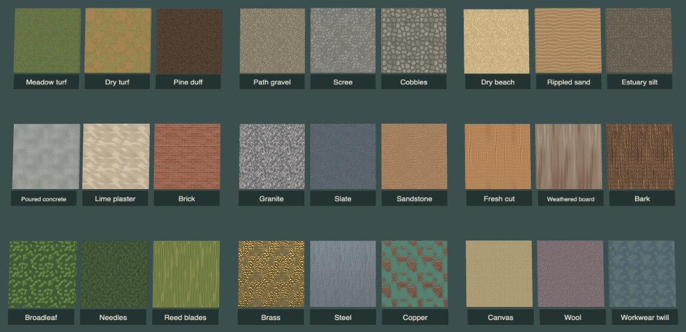
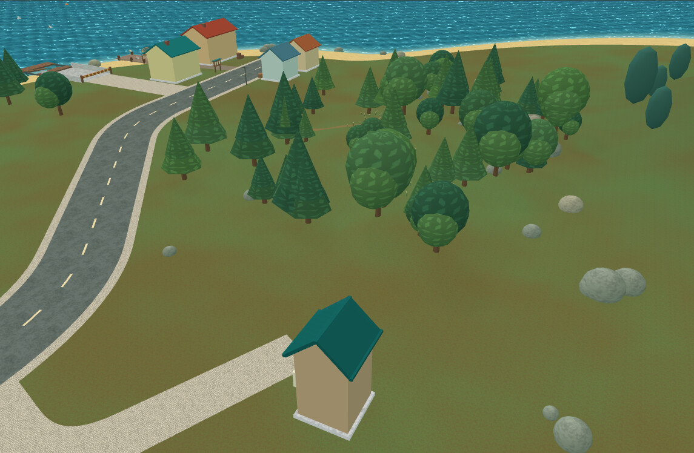
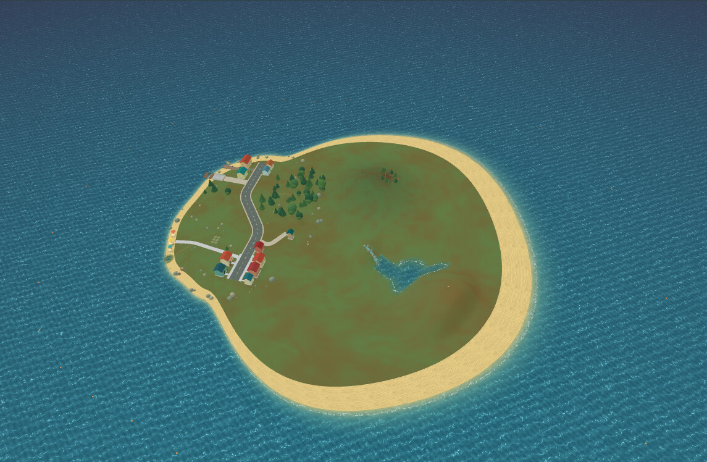

# Procedural surface catalog

Open **Surfaces → Texture gallery** and choose **Surface catalog** for the original 27 swatches in nine material families. Search the Library by name, group, or a finish term such as **salt-worn timber** or **drying cracks**. Each entry describes an example use and exposes feature spacing in millimetres, a material-specific wear control, relief, and tint.

Run `npm run dev` on the default port to open the setups below. Each link restores the recipe settings, camera, lighting, and studio or island context. Use **Copy setup link** to share your edits.

[Open the overcast catalog][catalog] · [Explore the gameplay surfaces](gameplay-surfaces.md)

## Tiles under grazing light

| Family | Close tile setups |
| --- | --- |
| Grass and forest ground | [Meadow turf][meadow-turf] · [Dry turf][dry-turf] · [Pine duff][pine-duff] |
| Loose aggregate | [Path gravel][path-gravel] · [Scree][scree] · [Cobbles][cobbles] |
| Sand and sediment | [Dry beach][dry-beach] · [Rippled sand][rippled-sand] · [Estuary silt][estuary-silt] |
| Masonry | [Poured concrete][poured-concrete] · [Lime plaster][lime-plaster] · [Brick][brick] |
| Exposed rock | [Granite][granite] · [Slate][slate] · [Sandstone][sandstone] |
| Timber | [Fresh cut][fresh-cut-timber] · [Weathered board][weathered-board] · [Bark][bark] |
| Foliage | [Broadleaf][broadleaf] · [Needles][needles] · [Reed blades][reed-blades] |
| Metal | [Brass][brass] · [Steel][steel] · [Copper][copper] |
| Cloth | [Canvas][canvas] · [Wool][wool] · [Workwear twill][workwear-twill] |

Orbit and zoom to inspect the normal detail. Choose **Overcast** to compare the structure under diffuse light. For a curved comparison, open a cylinder and rotate all the way around its side.

- Timber · [Fresh cut][fresh-cut-timber-cylinder] · [Weathered board][weathered-board-cylinder] · [Bark][bark-cylinder]
- Metal · [Brass][brass-cylinder] · [Steel][steel-cylinder] · [Copper][copper-cylinder]

## Starter Island field checks

Use **On island** to apply the current finish to the actual terrain, trail, or dock deck in the Workbench. Compare with **Studio** to inspect the same recipe on a tile.

| Preset | Studio | On island |
| --- | --- | --- |
| Meadow turf | [Overcast tile][meadow-turf-tile] | [Grassy rise close-up][meadow-turf-field] |
| Path gravel | [Overcast tile][path-gravel-tile] | [Harbor trail at a grazing angle][path-gravel-field] |
| Weathered board | [Overcast tile][weathered-board-tile] | [Dock planks at a grazing angle][weathered-board-field] |

The following views share the same meadow recipe and overcast light. As you zoom out, the tufts soften while the irregular ground patches and paths stay visible.

| [Grassy rise and Lookout Trail][meadow-turf-hill] | [Starter Island overview][meadow-turf-island] |
| --- | --- |
|  |  |

## Recipe sources and prior inventory

The original gallery had generic grass, gravel, sand, concrete, wood, stone, leaves, metal, and water samples, plus five standalone noise views. The individual material studies included a steel, brass, and copper selector. The gallery and shader drafts are still available, and existing subject IDs continue to open. The catalog counts the 27 named entries with measured spacing and separate surface structures.

The recipe table defines stable IDs, seeds, dimensions, control defaults, and example uses. The material factory consumes the procedural color, normal, and roughness maps with UV coordinates in metres. [Recipe table](../src/surface-recipes.ts) · [Material factory](../src/materials.ts) · [Workbench contribution guide](workbench.md#adding-a-subject)

[catalog]: http://localhost:5173/workbench.html#texture-gallery?setup=%7B%22version%22%3A1%2C%22name%22%3A%22Surface+catalog%22%2C%22time%22%3A0%2C%22camera%22%3A%7B%22alpha%22%3A1.5707963267948966%2C%22beta%22%3A0.04%2C%22fov%22%3A0.8%2C%22radius%22%3A10.9%2C%22target%22%3A%5B0%2C0.03%2C0%5D%7D%2C%22options%22%3A%7B%22pattern%22%3A%22catalog%22%2C%22spacing%22%3A1%7D%2C%22grid%22%3Afalse%2C%22wireframe%22%3Afalse%7D&light=overcast
[fresh-cut-timber-cylinder]: http://localhost:5173/workbench.html#fresh-cut-timber?setup=%7B%22version%22%3A1%2C%22name%22%3A%22Fresh+cut%22%2C%22time%22%3A0%2C%22camera%22%3A%7B%22alpha%22%3A0.88%2C%22beta%22%3A1.03%2C%22fov%22%3A0.8%2C%22radius%22%3A0.30191999999999997%2C%22target%22%3A%5B0%2C0.0816%2C0%5D%7D%2C%22options%22%3A%7B%22spacing%22%3A4%2C%22wear%22%3A0.37%2C%22relief%22%3A1%2C%22tint%22%3A%22%23d1a471%22%2C%22shape%22%3A%22cylinder%22%7D%2C%22grid%22%3Afalse%2C%22wireframe%22%3Afalse%7D&light=grazing
[weathered-board-cylinder]: http://localhost:5173/workbench.html#weathered-board?setup=%7B%22version%22%3A1%2C%22name%22%3A%22Weathered+board%22%2C%22time%22%3A0%2C%22camera%22%3A%7B%22alpha%22%3A0.88%2C%22beta%22%3A1.03%2C%22fov%22%3A0.8%2C%22radius%22%3A0.7246079999999999%2C%22target%22%3A%5B0%2C0.19584000000000001%2C0%5D%7D%2C%22options%22%3A%7B%22spacing%22%3A8%2C%22wear%22%3A0.59%2C%22relief%22%3A1%2C%22tint%22%3A%22%239b8065%22%2C%22shape%22%3A%22cylinder%22%7D%2C%22grid%22%3Afalse%2C%22wireframe%22%3Afalse%7D&light=grazing
[bark-cylinder]: http://localhost:5173/workbench.html#bark?setup=%7B%22version%22%3A1%2C%22name%22%3A%22Bark%22%2C%22time%22%3A0%2C%22camera%22%3A%7B%22alpha%22%3A0.88%2C%22beta%22%3A1.03%2C%22fov%22%3A0.8%2C%22radius%22%3A1.751136%2C%22target%22%3A%5B0%2C0.47328000000000003%2C0%5D%7D%2C%22options%22%3A%7B%22spacing%22%3A29%2C%22wear%22%3A0.55%2C%22relief%22%3A1%2C%22tint%22%3A%22%23896245%22%2C%22shape%22%3A%22cylinder%22%7D%2C%22grid%22%3Afalse%2C%22wireframe%22%3Afalse%7D&light=grazing
[brass-cylinder]: http://localhost:5173/workbench.html#brass?setup=%7B%22version%22%3A1%2C%22name%22%3A%22Brass%22%2C%22time%22%3A0%2C%22camera%22%3A%7B%22alpha%22%3A0.88%2C%22beta%22%3A1.03%2C%22fov%22%3A0.8%2C%22radius%22%3A0.8453759999999999%2C%22target%22%3A%5B0%2C0.22848%2C0%5D%7D%2C%22options%22%3A%7B%22spacing%22%3A14%2C%22wear%22%3A0.32%2C%22relief%22%3A1%2C%22tint%22%3A%22%23d8b36d%22%2C%22shape%22%3A%22cylinder%22%7D%2C%22grid%22%3Afalse%2C%22wireframe%22%3Afalse%7D&light=grazing
[steel-cylinder]: http://localhost:5173/workbench.html#steel?setup=%7B%22version%22%3A1%2C%22name%22%3A%22Steel%22%2C%22time%22%3A0%2C%22camera%22%3A%7B%22alpha%22%3A0.88%2C%22beta%22%3A1.03%2C%22fov%22%3A0.8%2C%22radius%22%3A0.24153599999999997%2C%22target%22%3A%5B0%2C0.06527999999999999%2C0%5D%7D%2C%22options%22%3A%7B%22spacing%22%3A1.6%2C%22wear%22%3A0.48%2C%22relief%22%3A1%2C%22tint%22%3A%22%23c4ced2%22%2C%22shape%22%3A%22cylinder%22%7D%2C%22grid%22%3Afalse%2C%22wireframe%22%3Afalse%7D&light=grazing
[copper-cylinder]: http://localhost:5173/workbench.html#copper?setup=%7B%22version%22%3A1%2C%22name%22%3A%22Copper%22%2C%22time%22%3A0%2C%22camera%22%3A%7B%22alpha%22%3A0.88%2C%22beta%22%3A1.03%2C%22fov%22%3A0.8%2C%22radius%22%3A0.6642239999999999%2C%22target%22%3A%5B0%2C0.17951999999999999%2C0%5D%7D%2C%22options%22%3A%7B%22spacing%22%3A11%2C%22wear%22%3A0.51%2C%22relief%22%3A1%2C%22tint%22%3A%22%23ca8c71%22%2C%22shape%22%3A%22cylinder%22%7D%2C%22grid%22%3Afalse%2C%22wireframe%22%3Afalse%7D&light=grazing
[meadow-turf-tile]: http://localhost:5173/workbench.html#meadow-turf?setup=%7B%22version%22%3A1%2C%22name%22%3A%22Meadow+turf%22%2C%22time%22%3A0%2C%22camera%22%3A%7B%22alpha%22%3A0.88%2C%22beta%22%3A1.03%2C%22fov%22%3A0.8%2C%22radius%22%3A2.96208%2C%22target%22%3A%5B0%2C0.09649199999999998%2C0%5D%7D%2C%22options%22%3A%7B%22spacing%22%3A55%2C%22wear%22%3A0.27%2C%22relief%22%3A1%2C%22tint%22%3A%22%23778d4b%22%7D%2C%22grid%22%3Afalse%2C%22wireframe%22%3Afalse%7D&light=overcast
[path-gravel-tile]: http://localhost:5173/workbench.html#path-gravel?setup=%7B%22version%22%3A1%2C%22name%22%3A%22Path+gravel%22%2C%22time%22%3A0%2C%22camera%22%3A%7B%22alpha%22%3A0.88%2C%22beta%22%3A1.03%2C%22fov%22%3A0.8%2C%22radius%22%3A1.9388159999999999%2C%22target%22%3A%5B0%2C0.06315839999999999%2C0%5D%7D%2C%22options%22%3A%7B%22spacing%22%3A36%2C%22wear%22%3A0.58%2C%22relief%22%3A1%2C%22tint%22%3A%22%23b9b094%22%7D%2C%22grid%22%3Afalse%2C%22wireframe%22%3Afalse%7D&light=overcast
[weathered-board-tile]: http://localhost:5173/workbench.html#weathered-board?setup=%7B%22version%22%3A1%2C%22name%22%3A%22Weathered+board%22%2C%22time%22%3A0%2C%22camera%22%3A%7B%22alpha%22%3A0.88%2C%22beta%22%3A1.03%2C%22fov%22%3A0.8%2C%22radius%22%3A0.646272%2C%22target%22%3A%5B0%2C0.021052799999999997%2C0%5D%7D%2C%22options%22%3A%7B%22spacing%22%3A8%2C%22wear%22%3A0.59%2C%22relief%22%3A1%2C%22tint%22%3A%22%239b8065%22%2C%22shape%22%3A%22tile%22%7D%2C%22grid%22%3Afalse%2C%22wireframe%22%3Afalse%7D&light=overcast
[meadow-turf-field]: http://localhost:5173/workbench.html#meadow-turf?setup=%7B%22version%22%3A1%2C%22name%22%3A%22Meadow+turf%22%2C%22time%22%3A0%2C%22camera%22%3A%7B%22alpha%22%3A2.3%2C%22beta%22%3A1.1%2C%22fov%22%3A0.8%2C%22radius%22%3A5.4%2C%22target%22%3A%5B-9%2C1.0073396400987646%2C35.7%5D%7D%2C%22options%22%3A%7B%22spacing%22%3A55%2C%22wear%22%3A0.27%2C%22relief%22%3A1%2C%22tint%22%3A%22%23778d4b%22%7D%2C%22grid%22%3Afalse%2C%22wireframe%22%3Afalse%7D&light=overcast&stage=island
[path-gravel-field]: http://localhost:5173/workbench.html#path-gravel?setup=%7B%22version%22%3A1%2C%22name%22%3A%22Path+gravel%22%2C%22time%22%3A0%2C%22camera%22%3A%7B%22alpha%22%3A2.05%2C%22beta%22%3A0.98%2C%22fov%22%3A0.8%2C%22radius%22%3A3.1%2C%22target%22%3A%5B-45%2C0.08%2C-23%5D%7D%2C%22options%22%3A%7B%22spacing%22%3A36%2C%22wear%22%3A0.58%2C%22relief%22%3A1%2C%22tint%22%3A%22%23b9b094%22%7D%2C%22grid%22%3Afalse%2C%22wireframe%22%3Afalse%7D&light=grazing&stage=island
[weathered-board-field]: http://localhost:5173/workbench.html#weathered-board?setup=%7B%22version%22%3A1%2C%22name%22%3A%22Weathered+board%22%2C%22time%22%3A0%2C%22camera%22%3A%7B%22alpha%22%3A0.88%2C%22beta%22%3A0.98%2C%22fov%22%3A0.8%2C%22radius%22%3A3.1%2C%22target%22%3A%5B-44%2C0.23%2C-33.25%5D%7D%2C%22options%22%3A%7B%22spacing%22%3A8%2C%22wear%22%3A0.59%2C%22relief%22%3A1%2C%22tint%22%3A%22%239b8065%22%2C%22shape%22%3A%22tile%22%7D%2C%22grid%22%3Afalse%2C%22wireframe%22%3Afalse%7D&light=grazing&stage=island
[meadow-turf-hill]: http://localhost:5173/workbench.html#meadow-turf?setup=%7B%22version%22%3A1%2C%22name%22%3A%22Grassy+rise+and+Lookout+Trail%22%2C%22time%22%3A0%2C%22camera%22%3A%7B%22alpha%22%3A0.45%2C%22beta%22%3A1.03%2C%22fov%22%3A0.8%2C%22radius%22%3A44%2C%22target%22%3A%5B-6%2C1.1%2C26%5D%7D%2C%22options%22%3A%7B%22spacing%22%3A55%2C%22wear%22%3A0.27%2C%22relief%22%3A1%2C%22tint%22%3A%22%23778d4b%22%7D%2C%22grid%22%3Afalse%2C%22wireframe%22%3Afalse%7D&light=overcast&stage=island
[meadow-turf-island]: http://localhost:5173/workbench.html#meadow-turf?setup=%7B%22version%22%3A1%2C%22name%22%3A%22Starter+Island+meadow+overview%22%2C%22time%22%3A0%2C%22camera%22%3A%7B%22alpha%22%3A0.26%2C%22beta%22%3A0.77%2C%22fov%22%3A0.8%2C%22radius%22%3A345%2C%22target%22%3A%5B-4%2C1.5%2C70%5D%7D%2C%22options%22%3A%7B%22spacing%22%3A55%2C%22wear%22%3A0.27%2C%22relief%22%3A1%2C%22tint%22%3A%22%23778d4b%22%7D%2C%22grid%22%3Afalse%2C%22wireframe%22%3Afalse%7D&light=overcast&stage=island
[meadow-turf]: http://localhost:5173/workbench.html#meadow-turf?setup=%7B%22version%22%3A1%2C%22name%22%3A%22Meadow+turf%22%2C%22time%22%3A0%2C%22grid%22%3Afalse%2C%22wireframe%22%3Afalse%2C%22camera%22%3A%7B%22alpha%22%3A0.88%2C%22beta%22%3A1.03%2C%22fov%22%3A0.8%2C%22radius%22%3A2.96208%2C%22target%22%3A%5B0%2C0.09649%2C0%5D%7D%2C%22options%22%3A%7B%22spacing%22%3A55%2C%22wear%22%3A0.27%2C%22relief%22%3A1%2C%22tint%22%3A%22%23778d4b%22%7D%7D&light=grazing
[dry-turf]: http://localhost:5173/workbench.html#dry-turf?setup=%7B%22version%22%3A1%2C%22name%22%3A%22Dry+turf%22%2C%22time%22%3A0%2C%22grid%22%3Afalse%2C%22wireframe%22%3Afalse%2C%22camera%22%3A%7B%22alpha%22%3A0.88%2C%22beta%22%3A1.03%2C%22fov%22%3A0.8%2C%22radius%22%3A3.168%2C%22target%22%3A%5B0%2C0.1032%2C0%5D%7D%2C%22options%22%3A%7B%22spacing%22%3A72%2C%22wear%22%3A0.62%2C%22relief%22%3A1%2C%22tint%22%3A%22%23a39756%22%7D%7D&light=grazing
[pine-duff]: http://localhost:5173/workbench.html#pine-duff?setup=%7B%22version%22%3A1%2C%22name%22%3A%22Pine+duff%22%2C%22time%22%3A0%2C%22grid%22%3Afalse%2C%22wireframe%22%3Afalse%2C%22camera%22%3A%7B%22alpha%22%3A0.88%2C%22beta%22%3A1.03%2C%22fov%22%3A0.8%2C%22radius%22%3A1.29254%2C%22target%22%3A%5B0%2C0.04211%2C0%5D%7D%2C%22options%22%3A%7B%22spacing%22%3A48%2C%22wear%22%3A0.4%2C%22relief%22%3A1%2C%22tint%22%3A%22%23886442%22%7D%7D&light=grazing
[path-gravel]: http://localhost:5173/workbench.html#path-gravel?setup=%7B%22version%22%3A1%2C%22name%22%3A%22Path+gravel%22%2C%22time%22%3A0%2C%22grid%22%3Afalse%2C%22wireframe%22%3Afalse%2C%22camera%22%3A%7B%22alpha%22%3A0.88%2C%22beta%22%3A1.03%2C%22fov%22%3A0.8%2C%22radius%22%3A1.93882%2C%22target%22%3A%5B0%2C0.06316%2C0%5D%7D%2C%22options%22%3A%7B%22spacing%22%3A36%2C%22wear%22%3A0.58%2C%22relief%22%3A1%2C%22tint%22%3A%22%23b9b094%22%7D%7D&light=grazing
[scree]: http://localhost:5173/workbench.html#scree?setup=%7B%22version%22%3A1%2C%22name%22%3A%22Scree%22%2C%22time%22%3A0%2C%22grid%22%3Afalse%2C%22wireframe%22%3Afalse%2C%22camera%22%3A%7B%22alpha%22%3A0.88%2C%22beta%22%3A1.03%2C%22fov%22%3A0.8%2C%22radius%22%3A3.168%2C%22target%22%3A%5B0%2C0.1032%2C0%5D%7D%2C%22options%22%3A%7B%22spacing%22%3A115%2C%22wear%22%3A0.38%2C%22relief%22%3A1%2C%22tint%22%3A%22%239d9b91%22%7D%7D&light=grazing
[cobbles]: http://localhost:5173/workbench.html#cobbles?setup=%7B%22version%22%3A1%2C%22name%22%3A%22Cobbles%22%2C%22time%22%3A0%2C%22grid%22%3Afalse%2C%22wireframe%22%3Afalse%2C%22camera%22%3A%7B%22alpha%22%3A0.88%2C%22beta%22%3A1.03%2C%22fov%22%3A0.8%2C%22radius%22%3A3.168%2C%22target%22%3A%5B0%2C0.1032%2C0%5D%7D%2C%22options%22%3A%7B%22spacing%22%3A174%2C%22wear%22%3A0.33%2C%22relief%22%3A1%2C%22tint%22%3A%22%239e9e91%22%7D%7D&light=grazing
[dry-beach]: http://localhost:5173/workbench.html#dry-beach?setup=%7B%22version%22%3A1%2C%22name%22%3A%22Dry+beach%22%2C%22time%22%3A0%2C%22grid%22%3Afalse%2C%22wireframe%22%3Afalse%2C%22camera%22%3A%7B%22alpha%22%3A0.88%2C%22beta%22%3A1.03%2C%22fov%22%3A0.8%2C%22radius%22%3A0.19388%2C%22target%22%3A%5B0%2C0.00632%2C0%5D%7D%2C%22options%22%3A%7B%22spacing%22%3A1.2%2C%22wear%22%3A0.22%2C%22relief%22%3A1%2C%22tint%22%3A%22%23e4cb95%22%7D%7D&light=grazing
[rippled-sand]: http://localhost:5173/workbench.html#rippled-sand?setup=%7B%22version%22%3A1%2C%22name%22%3A%22Rippled+sand%22%2C%22time%22%3A0%2C%22grid%22%3Afalse%2C%22wireframe%22%3Afalse%2C%22camera%22%3A%7B%22alpha%22%3A0.88%2C%22beta%22%3A1.03%2C%22fov%22%3A0.8%2C%22radius%22%3A3.168%2C%22target%22%3A%5B0%2C0.1032%2C0%5D%7D%2C%22options%22%3A%7B%22spacing%22%3A125%2C%22wear%22%3A0.27%2C%22relief%22%3A1%2C%22tint%22%3A%22%23c5a573%22%7D%7D&light=grazing
[estuary-silt]: http://localhost:5173/workbench.html#estuary-silt?setup=%7B%22version%22%3A1%2C%22name%22%3A%22Estuary+silt%22%2C%22time%22%3A0%2C%22grid%22%3Afalse%2C%22wireframe%22%3Afalse%2C%22camera%22%3A%7B%22alpha%22%3A0.88%2C%22beta%22%3A1.03%2C%22fov%22%3A0.8%2C%22radius%22%3A3.168%2C%22target%22%3A%5B0%2C0.1032%2C0%5D%7D%2C%22options%22%3A%7B%22spacing%22%3A105%2C%22wear%22%3A0.36%2C%22relief%22%3A1%2C%22tint%22%3A%22%23827968%22%7D%7D&light=grazing
[poured-concrete]: http://localhost:5173/workbench.html#poured-concrete?setup=%7B%22version%22%3A1%2C%22name%22%3A%22Poured+concrete%22%2C%22time%22%3A0%2C%22grid%22%3Afalse%2C%22wireframe%22%3Afalse%2C%22camera%22%3A%7B%22alpha%22%3A0.88%2C%22beta%22%3A1.03%2C%22fov%22%3A0.8%2C%22radius%22%3A0.96941%2C%22target%22%3A%5B0%2C0.03158%2C0%5D%7D%2C%22options%22%3A%7B%22spacing%22%3A12%2C%22wear%22%3A0.44%2C%22relief%22%3A1%2C%22tint%22%3A%22%23b2b5ad%22%7D%7D&light=grazing
[lime-plaster]: http://localhost:5173/workbench.html#lime-plaster?setup=%7B%22version%22%3A1%2C%22name%22%3A%22Lime+plaster%22%2C%22time%22%3A0%2C%22grid%22%3Afalse%2C%22wireframe%22%3Afalse%2C%22camera%22%3A%7B%22alpha%22%3A0.88%2C%22beta%22%3A1.03%2C%22fov%22%3A0.8%2C%22radius%22%3A2.96208%2C%22target%22%3A%5B0%2C0.09649%2C0%5D%7D%2C%22options%22%3A%7B%22spacing%22%3A88%2C%22wear%22%3A0.33%2C%22relief%22%3A1%2C%22tint%22%3A%22%23dccdb2%22%7D%7D&light=grazing
[brick]: http://localhost:5173/workbench.html#brick?setup=%7B%22version%22%3A1%2C%22name%22%3A%22Brick%22%2C%22time%22%3A0%2C%22grid%22%3Afalse%2C%22wireframe%22%3Afalse%2C%22camera%22%3A%7B%22alpha%22%3A0.88%2C%22beta%22%3A1.03%2C%22fov%22%3A0.8%2C%22radius%22%3A3.0294%2C%22target%22%3A%5B0%2C0.09868%2C0%5D%7D%2C%22options%22%3A%7B%22spacing%22%3A75%2C%22wear%22%3A0.49%2C%22relief%22%3A1%2C%22tint%22%3A%22%23b36b51%22%7D%7D&light=grazing
[granite]: http://localhost:5173/workbench.html#granite?setup=%7B%22version%22%3A1%2C%22name%22%3A%22Granite%22%2C%22time%22%3A0%2C%22grid%22%3Afalse%2C%22wireframe%22%3Afalse%2C%22camera%22%3A%7B%22alpha%22%3A0.88%2C%22beta%22%3A1.03%2C%22fov%22%3A0.8%2C%22radius%22%3A0.64627%2C%22target%22%3A%5B0%2C0.02105%2C0%5D%7D%2C%22options%22%3A%7B%22spacing%22%3A8%2C%22wear%22%3A0.45%2C%22relief%22%3A1%2C%22tint%22%3A%22%23b0aaa6%22%7D%7D&light=grazing
[slate]: http://localhost:5173/workbench.html#slate?setup=%7B%22version%22%3A1%2C%22name%22%3A%22Slate%22%2C%22time%22%3A0%2C%22grid%22%3Afalse%2C%22wireframe%22%3Afalse%2C%22camera%22%3A%7B%22alpha%22%3A0.88%2C%22beta%22%3A1.03%2C%22fov%22%3A0.8%2C%22radius%22%3A1.72339%2C%22target%22%3A%5B0%2C0.05614%2C0%5D%7D%2C%22options%22%3A%7B%22spacing%22%3A32%2C%22wear%22%3A0.32%2C%22relief%22%3A1%2C%22tint%22%3A%22%23707c87%22%7D%7D&light=grazing
[sandstone]: http://localhost:5173/workbench.html#sandstone?setup=%7B%22version%22%3A1%2C%22name%22%3A%22Sandstone%22%2C%22time%22%3A0%2C%22grid%22%3Afalse%2C%22wireframe%22%3Afalse%2C%22camera%22%3A%7B%22alpha%22%3A0.88%2C%22beta%22%3A1.03%2C%22fov%22%3A0.8%2C%22radius%22%3A2.42352%2C%22target%22%3A%5B0%2C0.07895%2C0%5D%7D%2C%22options%22%3A%7B%22spacing%22%3A60%2C%22wear%22%3A0.49%2C%22relief%22%3A1%2C%22tint%22%3A%22%23c6a17c%22%7D%7D&light=grazing
[fresh-cut-timber]: http://localhost:5173/workbench.html#fresh-cut-timber?setup=%7B%22version%22%3A1%2C%22name%22%3A%22Fresh+cut%22%2C%22time%22%3A0%2C%22grid%22%3Afalse%2C%22wireframe%22%3Afalse%2C%22camera%22%3A%7B%22alpha%22%3A0.88%2C%22beta%22%3A1.03%2C%22fov%22%3A0.8%2C%22radius%22%3A0.26928%2C%22target%22%3A%5B0%2C0.00877%2C0%5D%7D%2C%22options%22%3A%7B%22spacing%22%3A4%2C%22wear%22%3A0.37%2C%22relief%22%3A1%2C%22tint%22%3A%22%23d1a471%22%2C%22shape%22%3A%22tile%22%7D%7D&light=grazing
[weathered-board]: http://localhost:5173/workbench.html#weathered-board?setup=%7B%22version%22%3A1%2C%22name%22%3A%22Weathered+board%22%2C%22time%22%3A0%2C%22grid%22%3Afalse%2C%22wireframe%22%3Afalse%2C%22camera%22%3A%7B%22alpha%22%3A0.88%2C%22beta%22%3A1.03%2C%22fov%22%3A0.8%2C%22radius%22%3A0.64627%2C%22target%22%3A%5B0%2C0.02105%2C0%5D%7D%2C%22options%22%3A%7B%22spacing%22%3A8%2C%22wear%22%3A0.59%2C%22relief%22%3A1%2C%22tint%22%3A%22%239b8065%22%2C%22shape%22%3A%22tile%22%7D%7D&light=grazing
[bark]: http://localhost:5173/workbench.html#bark?setup=%7B%22version%22%3A1%2C%22name%22%3A%22Bark%22%2C%22time%22%3A0%2C%22grid%22%3Afalse%2C%22wireframe%22%3Afalse%2C%22camera%22%3A%7B%22alpha%22%3A0.88%2C%22beta%22%3A1.03%2C%22fov%22%3A0.8%2C%22radius%22%3A1.56182%2C%22target%22%3A%5B0%2C0.05088%2C0%5D%7D%2C%22options%22%3A%7B%22spacing%22%3A29%2C%22wear%22%3A0.55%2C%22relief%22%3A1%2C%22tint%22%3A%22%23896245%22%2C%22shape%22%3A%22tile%22%7D%7D&light=grazing
[broadleaf]: http://localhost:5173/workbench.html#broadleaf?setup=%7B%22version%22%3A1%2C%22name%22%3A%22Broadleaf%22%2C%22time%22%3A0%2C%22grid%22%3Afalse%2C%22wireframe%22%3Afalse%2C%22camera%22%3A%7B%22alpha%22%3A0.88%2C%22beta%22%3A1.03%2C%22fov%22%3A0.8%2C%22radius%22%3A2.12058%2C%22target%22%3A%5B0%2C0.06908%2C0%5D%7D%2C%22options%22%3A%7B%22spacing%22%3A105%2C%22wear%22%3A0.31%2C%22relief%22%3A1%2C%22tint%22%3A%22%23749745%22%7D%7D&light=grazing
[needles]: http://localhost:5173/workbench.html#needles?setup=%7B%22version%22%3A1%2C%22name%22%3A%22Needles%22%2C%22time%22%3A0%2C%22grid%22%3Afalse%2C%22wireframe%22%3Afalse%2C%22camera%22%3A%7B%22alpha%22%3A0.88%2C%22beta%22%3A1.03%2C%22fov%22%3A0.8%2C%22radius%22%3A2.0196%2C%22target%22%3A%5B0%2C0.06579%2C0%5D%7D%2C%22options%22%3A%7B%22spacing%22%3A75%2C%22wear%22%3A0.22%2C%22relief%22%3A1%2C%22tint%22%3A%22%238fa653%22%7D%7D&light=grazing
[reed-blades]: http://localhost:5173/workbench.html#reed-blades?setup=%7B%22version%22%3A1%2C%22name%22%3A%22Reed+blades%22%2C%22time%22%3A0%2C%22grid%22%3Afalse%2C%22wireframe%22%3Afalse%2C%22camera%22%3A%7B%22alpha%22%3A0.88%2C%22beta%22%3A1.03%2C%22fov%22%3A0.8%2C%22radius%22%3A1.99267%2C%22target%22%3A%5B0%2C0.06491%2C0%5D%7D%2C%22options%22%3A%7B%22spacing%22%3A37%2C%22wear%22%3A0.35%2C%22relief%22%3A1%2C%22tint%22%3A%22%239da552%22%7D%7D&light=grazing
[brass]: http://localhost:5173/workbench.html#brass?setup=%7B%22version%22%3A1%2C%22name%22%3A%22Brass%22%2C%22time%22%3A0%2C%22grid%22%3Afalse%2C%22wireframe%22%3Afalse%2C%22camera%22%3A%7B%22alpha%22%3A0.88%2C%22beta%22%3A1.03%2C%22fov%22%3A0.8%2C%22radius%22%3A0.75398%2C%22target%22%3A%5B0%2C0.02456%2C0%5D%7D%2C%22options%22%3A%7B%22spacing%22%3A14%2C%22wear%22%3A0.32%2C%22relief%22%3A1%2C%22tint%22%3A%22%23d8b36d%22%2C%22shape%22%3A%22tile%22%7D%7D&light=grazing
[steel]: http://localhost:5173/workbench.html#steel?setup=%7B%22version%22%3A1%2C%22name%22%3A%22Steel%22%2C%22time%22%3A0%2C%22grid%22%3Afalse%2C%22wireframe%22%3Afalse%2C%22camera%22%3A%7B%22alpha%22%3A0.88%2C%22beta%22%3A1.03%2C%22fov%22%3A0.8%2C%22radius%22%3A0.21542%2C%22target%22%3A%5B0%2C0.00702%2C0%5D%7D%2C%22options%22%3A%7B%22spacing%22%3A1.6%2C%22wear%22%3A0.48%2C%22relief%22%3A1%2C%22tint%22%3A%22%23c4ced2%22%2C%22shape%22%3A%22tile%22%7D%7D&light=grazing
[copper]: http://localhost:5173/workbench.html#copper?setup=%7B%22version%22%3A1%2C%22name%22%3A%22Copper%22%2C%22time%22%3A0%2C%22grid%22%3Afalse%2C%22wireframe%22%3Afalse%2C%22camera%22%3A%7B%22alpha%22%3A0.88%2C%22beta%22%3A1.03%2C%22fov%22%3A0.8%2C%22radius%22%3A0.59242%2C%22target%22%3A%5B0%2C0.0193%2C0%5D%7D%2C%22options%22%3A%7B%22spacing%22%3A11%2C%22wear%22%3A0.51%2C%22relief%22%3A1%2C%22tint%22%3A%22%23ca8c71%22%2C%22shape%22%3A%22tile%22%7D%7D&light=grazing
[canvas]: http://localhost:5173/workbench.html#canvas?setup=%7B%22version%22%3A1%2C%22name%22%3A%22Canvas%22%2C%22time%22%3A0%2C%22grid%22%3Afalse%2C%22wireframe%22%3Afalse%2C%22camera%22%3A%7B%22alpha%22%3A0.88%2C%22beta%22%3A1.03%2C%22fov%22%3A0.8%2C%22radius%22%3A0.1584%2C%22target%22%3A%5B0%2C0.00516%2C0%5D%7D%2C%22options%22%3A%7B%22spacing%22%3A1.6%2C%22wear%22%3A0.23%2C%22relief%22%3A1%2C%22tint%22%3A%22%23c9b98b%22%7D%7D&light=grazing
[wool]: http://localhost:5173/workbench.html#wool?setup=%7B%22version%22%3A1%2C%22name%22%3A%22Wool%22%2C%22time%22%3A0%2C%22grid%22%3Afalse%2C%22wireframe%22%3Afalse%2C%22camera%22%3A%7B%22alpha%22%3A0.88%2C%22beta%22%3A1.03%2C%22fov%22%3A0.8%2C%22radius%22%3A0.1584%2C%22target%22%3A%5B0%2C0.00516%2C0%5D%7D%2C%22options%22%3A%7B%22spacing%22%3A2.8%2C%22wear%22%3A0.43%2C%22relief%22%3A1%2C%22tint%22%3A%22%23a39093%22%7D%7D&light=grazing
[workwear-twill]: http://localhost:5173/workbench.html#workwear-twill?setup=%7B%22version%22%3A1%2C%22name%22%3A%22Workwear+twill%22%2C%22time%22%3A0%2C%22grid%22%3Afalse%2C%22wireframe%22%3Afalse%2C%22camera%22%3A%7B%22alpha%22%3A0.88%2C%22beta%22%3A1.03%2C%22fov%22%3A0.8%2C%22radius%22%3A0.1584%2C%22target%22%3A%5B0%2C0.00516%2C0%5D%7D%2C%22options%22%3A%7B%22spacing%22%3A1.1%2C%22wear%22%3A0.38%2C%22relief%22%3A1%2C%22tint%22%3A%22%2368848c%22%7D%7D&light=grazing
