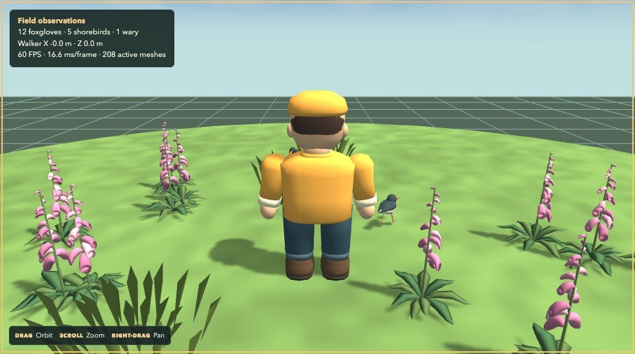

# Asset Workbench

Choose a workspace to narrow the library to one job. Search matches words in subject names, descriptions, groups and workspace names across the whole catalog. Enter opens the first result and Escape clears the search. A subject’s URL works directly, including the original landscape, biome and material bookmarks.

| Workspace | What to inspect or change |
| --- | --- |
| World | Orbit Starter Island, jump to a landmark, place or move draft objects, walk the terrain, compare saved shots, or launch the Saltwind tour. |
| Ecology | Scrub hare and fox poses. Compare clover and tussock seeds and growth. Use the Biome Composer for feeding, pursuit, concealment and rain responses. |
| Construction | Edit named Starter Island furnishings in place. Review Starter houses and combine Saltwind roof, tower, canopy, width and paint options at their actual addresses. |
| Surfaces | Compare the procedural texture gallery, edit substance-specific finishes, and run [interactive shader studies](shader-studies.md) and [twenty additional studies](more-shader-studies.md) in the studio and on Starter Island. |
| Effects | Audition 52 seeded effects at crew or truck scale. Scrub the burst, adjust the source footprint, or open the Tarnstep and Forest Lookout field setups. Listen to the Starter Island surf, footstep and crate sounds under **Sound**. |
| Characters | Try a uniform, fabric dye or cap while posing the crew. Rehearse offering, accepting and fulfilling a fish order with a stand-in shopkeeper at Seabrook Market. |
| Vehicles | Inspect exteriors and lights. Compare vehicles on a neutral stage and at their parking or landing sites. |
| Mechanics | Replay a cargo throw, compare fishing strategies, or set the crop stage in the actual field. |

See the [Effects shelf and field checks](effects-workbench.md) for the preview sheet, shared setups, and on/off timing results.

## An editing session

Open **Construction → Site furnishings → Seabrook village bench**. Select **On island** and move the bench using east and north offsets in metres. Its inspector, camera controls and geometry check stay available. **Save to landscape draft** applies the edit to Starter Island in this browser’s Workbench. **Inspect this location** returns to the landscape camera at the bench. To undo a published draft placement, reset the subject’s settings and save again. **Export placement JSON** produces coordinates, heading, size and finish suitable for review against the matching entry in `src/worlds/starter/sites.ts`. Collision geometry and the multiplayer map are authored separately.

Use **Saved variations** to build a named, browser-local collection for a subject. Each variation restores its controls, viewport and clock. Use **Copy setup link** to share a specific model, context, parameter set, camera, lighting and paused time. Use a LAN address when sharing between computers. Landscape studies and biome recipes retain their specialized formats. The map’s **Save layout** and **Export JSON** manage additional placed objects. Scene drafts and setups run separately from multiplayer saves.

## Procedural surfaces

Open **Surfaces → Texture gallery** to compare 54 named materials across **Surface catalog** and **Gameplay surfaces**, or select a family in the Library. Use **Grazing light** to reveal relief, **Overcast** for diffuse light, and **Dusk** to see glow algae emit light. Meadow turf, Path gravel, and Weathered board also have an **On island** view. Both collections include contact sheets and reopenable setups. [Surface catalog](surface-catalog.md) · [Gameplay surfaces](gameplay-surfaces.md)

## Compare an asset with a reference photo

Open **Reference image** beside the subject title. Paste a direct image URL or a Wikimedia Commons **File:** page, add a **Photo description** of the detail you want to compare, then choose **Load image**. The description is optional and supplies the image’s alternative text. **Search Wikimedia Commons** opens a search for the current asset. For a Commons file page, **File & license** opens the original credit and licensing information. You can orbit, animate, or change the model while the photograph stays in place.

Scroll or pinch over the photo to zoom toward a detail, then drag to pan. The **+** and **−** buttons zoom around the center. Use the four **Pan** buttons to explore the enlarged photo one step at a time. You can also Tab to the photo and press **+** or **−** to zoom, the **arrow keys** to pan, and **Home** to fit. The model camera stays in place. Press **Escape** inside the pane to return to the **Reference image** button.

The Workbench remembers the reference and its framing per asset in this browser. Hide it with **Reference image**, or select **Remove** to forget it. **Copy setup link** includes the visible photo crop alongside the camera and asset settings so a teammate can open the comparison on another computer.

For the player model, open **Wardrobe → Crew character → Compare turnaround**, or use the [crew fitting shortcut](http://localhost:5173/workbench.html#crew?fitting=turnaround) on the default development port. **Front**, **Side** and **Back** frame the corresponding figure in the concept sheet and turn the model to match. Each starts with the same bareheaded courier in daylight. You can then orbit, try another outfit or scrub a pose beside the drawing. Under **Zoom and pan**, choose **Fit** to see the full sheet. Use **Copy setup link** after making adjustments to share that exact view.

In the crew inspector, **Outfit preset** previews a complete uniform. Picking a shirt, swimsuit, hat, trousers, or shoes switches a work uniform to everyday clothes so the piece is visible. The inspector shows **Default** for slots supplied by a uniform and restores your everyday selections when you return to everyday clothes. Picking trousers replaces a swimsuit with the default shirt. **Show cap** controls visibility, and selecting a specific cap turns it back on. Turn off **Use custom shirt and cap dye** to compare the stock colors.

### Prepare a comparison link from the command line

Choose the asset in the Library and use its address or **Copy setup link** to include the model camera and settings. The asset ID follows the first `#` (for example, `clover`). Find a Commons file page showing the feature you want to study and check the credit and license on that page. From the checkout, run the following with the host and port your reviewer can reach.

```sh
npm run --silent workbench:reference -- \
  'http://localhost:5173/workbench.html#clover' \
  'https://commons.wikimedia.org/wiki/File:White_clover.jpg' \
  --crop '2.25,0.31626,0.56572' \
  --description 'White clover flower head with many small florets.'
```

The command writes one URL to standard output and exits nonzero for invalid input. Omit `--crop` to show the whole photo. The three numbers are magnification (above 1 through 8) and the focal point measured from the left and top of the full image (0 through 1). The visible edges depend on the reviewer’s pane size. For a link assembled directly, use `URLSearchParams` in the **fragment** for `ref`, optional `crop`, and optional `refAlt` (up to 300 characters). Keep existing setup and recipe parameters. [Clover reference and license](https://commons.wikimedia.org/wiki/File:White_clover.jpg)

To verify a handoff, open its link in a fresh browser profile. Check the subject title, the photo’s accessible description and magnification, and the source link. Pan the photo and confirm the model camera stays put.

## Audition island sound

Open **Effects → Sound → Starter Island sound**. Choose a **Sound layer**, then **Play** for one cue or **Repeat** to keep it going at the chosen pace. **Stop** ends playback. The first click in a fresh tab starts audio. Each layer has its own controls:

- **Surf:** breaker strength and spacing.
- **Footsteps:** surface and walking pace.
- **Crate impact:** drop strength and receiving surface.

**Seed** picks related variations. **Listener distance** places the source ahead and to the right of the listener. Clear **Spatial audition** for an unspatialised baseline at the recipe's own level. Clear **Solo layer** to hear all three layers together. The observations line shows the audio state, the active layer, the last cue and the voice count, so you can inspect a muted session. **Copy setup link** keeps the seed, distance and recipe settings, and the game uses the same recipes from `src/audio/recipes.ts`.

## Adding a subject

1. Register an `Entry` from `src/workbench/subject.ts` in an appropriate study module. Give it a stable ID, a library group and the path to its source. Group membership determines its workspace.
2. Use the same model factory, shader, recipe, and attachment data that the game uses. Let the study supply its own camera, initial state, and replay timing. Identify any stand-ins for scenery or interactions that the game has yet to implement. Use live controls for pose and placement and commit geometry changes when the control is released.
3. For a timed subject, implement scrubbing and paused frames. For interactive trials, expose actions with their availability and use the observation panel for quantities or outcomes a designer would otherwise have to guess.
4. Supply a field site when the subject has a meaningful setting. Render the subject at its production placement and omit the original instance if the study supplies a controlled version. Check contact points, poses, and clearances in both settings.
5. Exercise a shared setup in a fresh browser tab. Verify that settings, time, camera and site survive, and that the trial leaves live saves untouched.

## Scope of the trials

The cargo trial steps the actual Cannon simulation at the server’s fixed rate. The fishing trial uses the server’s cast validation, bite probability and fight rules. It guarantees a bite after a valid cast so reeling strategies can be compared. The farm preview exposes crop states. The **Resident routines** study reads each resident's real schedule and conversation. Choose a resident and an hour, then set the crew's trust, the resident's standing, the favor's state and the rain to hear what they would say. Change the remark seed to hear other small talk that fits the same moment. On the island, the stage moves to where that resident is at that hour.

Further work can add named plant species backed by shared generators, collision updates for edited scenery, and a versioned catalog of approved material and building recipes. Each can use the existing subject, field site and setup-link conventions.

## Walk the coastal meadow

Open **Ecology → Biome Composer**, select **Coastal meadow** and choose **Apply**. The crew member starts at the edge of a 16 m clearing with 12 foxgloves and five oystercatchers. Click or Tab to the viewport and hold **W/A/S/D** to walk relative to the camera. Drag to orbit and scroll to change distance. Clear **Walk the clearing** to return to the overview.

Move toward the birds and watch the wary count rise as they stop probing and walk away. Change **Foxglove stems** (0–32) and **Oystercatchers** (0–12) separately. The seed keeps plant and bird starting locations comparable across counts. A population edit rebuilds the habitat and keeps the walker's position. **Copy recipe link** and **Export JSON** include both counts.



For a laptop performance check, hold the same view for a few seconds each at 0/0, 12/5 and 32/12. **Field observations** shows the observed frame rate, milliseconds per frame and active meshes. Record the viewport size and browser with the readings. Repeat while walking through the densest patch to check for stutter during movement.

## Scout Windstone Ridge

Run `npm run dev` and open [Windstone Ridge glider scout](http://localhost:5173/workbench.html#ridge-glider-scout?stage=island). Choose the landing circle or the willow to see a direct line of blue orbs to that destination. Focus the viewport and press **E** to launch, **A/D** to bank and turn, **W** to lower the nose, and **S** to pull up. Drag to orbit, or press **C** to switch between the close and island views. After touchdown, walk uphill to the windsock with **WASD**. Press **R** to reset the scout.

The current course starts at (39, 128) on the south shoulder, about 34 m from and 13 m above the meadow at (61, 102). The return route bends via (48, 116). The original candidate at (38, 132) clips the lichen rocks once the wing and rock geometry are included. The Workbench trial uses these provisional positions and a fixed wind. The [Starter Island manual checklist](https://github.com/brylie/mission-island/issues/52) covers the future two-player outing.

## Fish schooling trial

In **Ecology → Biome Composer**, choose **Open fish schooling trial**. Six fish cruise in an isolated pool. Watch the default crossing, then choose **Wading player** or **Paddled skiff** and replay the same seed. A click on the water redirects the actor. With the canvas focused, tap **W/A/S/D** to direct it two metres relative to the current view. Press **Space** to pause or resume.

**Randomize school** starts a fresh encounter with a different shoal shape, heading and set of individual speeds. For a controlled comparison, enter seed **125**, select the skiff, and watch the default crossing. Pause at 25 seconds and toggle **Nudge fish 1 east by 5 cm**. Only that initial position changes. Look for differences downstream in who scatters or takes the lead. The setup link retains the nudge as well as the seed.

Each follower sees the leader's recent path with its own short delay. Seeded, mean-reverting Brownian noise gently varies each fish's direction. A fish can bank more sharply while startled. Its body turns with its direction of travel, including when it slows to regroup.

Approach one flank, then move away. Watch which fish turn first, follow their trails, and look for the gold ring around the fish they regroup on. Make a second pass from the opposite side. Rewind to replay your recorded route; steering after a rewind replaces subsequent moves. **Copy setup link** includes the route, actor, seed, view and timeline position. **Reset** restores the default crossing. The [Driftwood field playtest](https://github.com/brylie/mission-island/issues/68) follows this Composer trial.

### Two-player Driftwood field trial

Open the same Starter Island game address on both computers. Walk to Driftwood Beach in daylight. One player stands on the sand beside the middle parasol and looks out over the wet sand toward the school. The other approaches one flank through the shallows, pauses, then backs away. Have the observer point out the first fish to turn and where the group reforms before comparing what each person saw.

Repeat with one player paddling the skiff from the small fishing dock along the southern shoreline. Cross the school, carry on past it, and give the fish room to settle. Try approaching from opposite sides on foot, then refreshing one browser while the other keeps watching. Look for fish showing through the hull, disappearing against the sand, or popping above the foam as the camera moves.

The host advances six fish at 30 steps per second and broadcasts their positions, headings, startle states and regroup leader together. A reconnect picks up the current encounter. For a repeatable solo inspection, focus the Landscape Workbench near **X 33.4 m, Z −42.9 m**. It runs an undisturbed school from a fixed seed.
